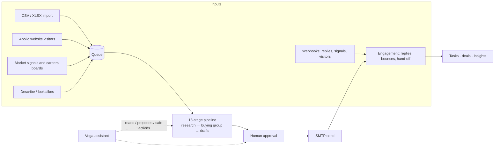

# 01 · Product overview

> **Evidence labels used in every file of this package:**
> - **[Code]**: verified by reading the source.
> - **[Runtime]**: observed on the live system during this engagement, through read-only database queries and the deployment list.
> - **[Assumption]**: inferred from the code, not proven.
> - **[Verify]**: needs a check against the running system.
>
> **Redaction:** client companies are called *Client A* (the built-in, default seller) and *Client B*, and people are referred to by role. No keys, tokens, hostnames, project IDs or email addresses appear anywhere in the package.

## What the application is for
ABM Intelligence is an **account-based marketing (ABM) and outbound sales workbench** for B2B sellers. It is multi-tenant: one installation serves several seller "clients". For each client it:
1. collects target companies (import, website visitors, market signals, descriptions, lookalikes);
2. qualifies and **researches** each company with web search and LLM extraction, keeping sources and confidence;
3. finds the **buying group** (people and roles) and enriches contacts;
4. **drafts personalised emails** (and LinkedIn notes), runs them through critics, and queues them for **human approval**;
5. sends approved emails, tracks replies and bounces, and hands warm accounts to sales;
6. reports on what's working.

An assistant called **Vega** (formerly "JARVIS") sits on top. It answers questions, does safe in-app work on its own, reacts to events, and recommends approvals. A person always confirms anything that goes out. [Code]

## Intended users
| User | What they do |
|---|---|
| **Super Admin** (agency operator) | Manages all clients, users, integration keys, budgets and the AI pause; uses Vega; sees the audit log and system health. |
| **Client owner** | Edits the Account Brain (ideal customer, rules), the seller pack and knowledge base. |
| **Manager / Rep** | Works the daily queue, approves emails, handles replies, hand-offs, tasks and deals. |
| **Viewer** | Read-only. |

Roles: `src/lib/roles.ts`. Super Admin: `src/lib/me.ts`. [Code]

## Main workflows
- **Find companies:** Prospecting → Import hub (`/import/*`), Market signals (`/discover`), Website visitors (`/import/apollo`).
- **Research:** a 13-stage pipeline (`src/lib/pipeline/stages/*`) driven by a queue and a daily tick.
- **Engage:** Today (`/work/today`), Approvals (`/review`), Emails (`/outreach`), Hand-offs, Tasks, Deals.
- **Learn and report:** Insights (`/analytics`), Overview, Pipeline (what the brain did and why).
- **Administer:** Team & Access (`/team`), Integrations, Brain and Settings.

## Implementation status (summary; detail in 07 and 11)
- **Implemented and covered by tests [Code]:** everything listed above, the Vega engine Levels 0–3, multi-tenancy, per-client API keys, budgets and the AI pause.
- **Partial or limited:**
  - LinkedIn is copy-and-send only, with no API.
  - The CRM is internal only; there is no Salesforce or HubSpot integration.
  - There is no third-party intent provider.
  - Slack/Teams alerts are "planned".
  - Vega is Super Admin only.
- **Pending:** the P0-1 "contract" database migration, which needs owner approval.
- **Planned (from the Vega roadmap, not started):** an always-on 15-minute schedule, team access to Vega, plays, WhatsApp/Slack, mailbox and CRM sync, job-change detection, voice.

