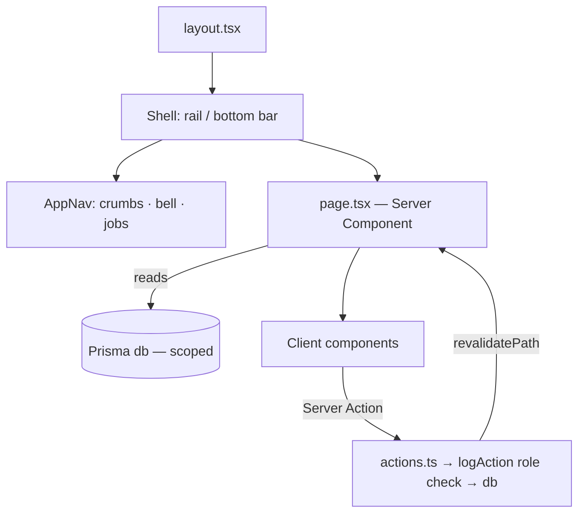

# 02 · Frontend architecture

## Stack [Code]
- **Framework:** Next.js 16 App Router with React 19. Pages are React Server Components; mutations use Server Actions.
  - `AGENTS.md` warns that this Next version differs from older ones; check `node_modules/next/dist/docs/`.
  - Next 16 uses `src/proxy.ts` instead of `middleware.ts`.
- **Styling:** Tailwind v4 (`src/app/globals.css`, `@tailwindcss/postcss`) plus a token system in `src/app/design.css` (about 2.5k lines).
- **Charts:** Recharts 3 (`src/components/charts.tsx`), plus local Donut/GroupedBars components in analytics and home.
- **Icons:** lucide-react. **Font:** Geist.

## App shell
- **`src/app/layout.tsx`:**
  - `force-dynamic`; counts badges, resolves the client scope, and runs a queue watchdog in `after()`.
  - An inline theme script sets `data-theme` before paint, so there's no flash.
  - Renders a skip link, `UndoProvider`, `ToastHost`, `CommandPalette`, `QuickTask` and `AdminAssistant`.
- **`src/components/shell/Shell.tsx`:**
  - The glass rail: Home, Accounts, Prospecting, Engage, Pipeline, Insights, Clients, Admin.
  - On phones, a bottom bar with a "More" sheet.
  - Gate screens for removed users and users with no client.
  - `VegaKey` (Cmd/Ctrl+J).
- **`src/lib/nav.ts`:** `SECTIONS` (the module map), `IMPORT_PAGES`, `shown()` (hides "extra" pages unless a Super Admin turns extras on), `locate()` (breadcrumbs).
- **`src/components/shell/AppNav.tsx`:** top bar with breadcrumbs, `NotificationBell`, `JobsIndicator`, `SuperAdminSwitch`.

## Routes [Code]
**Visibility:**
- Roles gate *actions*, not pages, so a viewer can open any page but can't change anything.
- Super Admin-only pages: `/team`, `/team/client/[id]`, and Vega (`/vega` and the Home core).
- "Extra" pages are hidden from menus but still reachable by URL.

| Area | Routes |
|---|---|
| Home | `/` (dashboard and the Vega core) |
| Accounts | `/accounts`, `/accounts/[id]`, `/accounts/coverage`(extra), `/people`, `/people/[id]`, `/signals`(extra) |
| Prospecting | `/import`, `/import/upload`, `/import/describe`, `/import/lookalikes`(extra), `/import/apollo` (website visitors), `/discover`(extra) |
| Engage | `/work/today`, `/review`, `/outreach`, `/handoffs`, `/crm/opportunities`, `/crm/tasks` |
| Insights | `/overview`, `/analytics`, `/pipeline`(extra) |
| Admin | `/admin`, `/admin/integrations`, `/brain`, `/settings/*`, `/team`, `/team/client/[id]`, `/clients`, `/me` |
| Assistant | `/vega`; `/jarvis` permanently redirects to it (`next.config.ts`) |
| Auth | `/login`, `/login/verify` |
| Legacy redirects | `/companies`, `/crm`, `/crm/contacts`, `/work` |
| Dev only | `/kit` (component demo, not linked anywhere) |

## Components (`src/components`) [Code]
- **`shell/`:** the shell, nav, palette, quick task, notifications, jobs, Vega key.
- **`kit/`:** a newer design kit (PageHeader, Stat, Badge, DataTable, FilterBar, DecisionCard, FormField, Undo, and others). **Low adoption:** DataTable, FilterBar, DecisionCard and FormField appear to be used only by `/kit`. [Assumption: import search only]
- **`ui.tsx`, `v2.tsx`, `client.tsx`:** older primitives (Card, Badge, Kpi, ActionForm, ActionButton, Modal, Toast). PageHeader and Badge exist in both `ui.tsx` and the kit.
- **`peek/`:** side panels, stepper, and keyboard list navigation (`list-keys.tsx`). `approval-keys.tsx` may be orphaned. [Verify]
- **`home/`:** includes `vega-orb.tsx` (the animated SVG core, hover card and side-panel portal).
- **Feature components:** `saved-views.tsx`, import wizard, queue panel, why-this-email, reply assistant, web visits, opp mover.

## Interaction patterns [Code]
- **Filters** live in URL search params, rendered on the server (`accounts/filters.tsx` FilterPanel and ActiveChips).
- **Saved views** on Accounts and People. **Bulk tick actions** on Accounts, People and Tasks. **CSV export** (`ExportTicked`, `/people/export`).
- **Undo toasts** after reversible actions.
- **Keyboard shortcuts:**
  - Cmd/Ctrl+K or `/` opens the command palette.
  - j/k move through lists.
  - Single keys act on approvals.
  - Cmd/Ctrl+J opens Vega.

## Design tokens and responsive behaviour [Code]
- **`design.css`** holds the semantic tokens on `:root` and a `[data-theme="dark"]` block.
  - `scripts/check-tokens.mjs` (`npm run lint:tokens`) forbids raw colours and px font sizes below the "Type" marker.
  - Elsewhere it enforces a ratchet against `scripts/token-baseline.json`.
- **`globals.css`** still contains older tokens and around 60 dark-mode rules with raw hex values. This is debt.
- **Breakpoints are inconsistent** (about 25 distinct widths; the main ones are 640, 768, 900, 1024 and 1280). `prefers-reduced-motion` is honoured in 9 blocks.
- **Unused fonts:** several `@fontsource` packages (Inter, IBM Plex, Poppins) appear unused. [Assumption]
