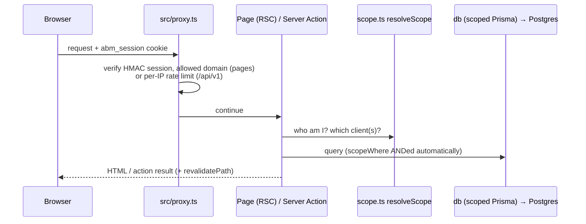
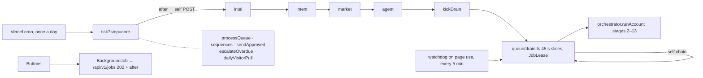

# 03 · Backend architecture

## Request flow [Code]

## Authentication and authorisation [Code]
- **Sessions** (`src/lib/auth.ts`):
  - HMAC-SHA256 signed cookie that lasts 14 days. A version counter allows signing out everywhere.
  - The signing secret is `AUTH_SECRET`, which **falls back to `CRON_SECRET`** (a risk).
  - An email-domain allowlist is set by env, and there's a default domain in code (redacted here).
  - Emailed one-time links last 15 minutes when SMTP is configured.
  - Login is rate-limited to 10 attempts per 15 minutes.
- **Gate** (`src/proxy.ts`): on by default in production (`AUTH_REQUIRED`).
- **Roles** (`src/lib/roles.ts`):
  - `minRoleFor(actionPrefix)` maps action types to a minimum role:
    - `email.`, `linkedin.`, `decision.` and `deal.` need **rep**;
    - `brain.`, `settings.` and `members.` need **owner**;
    - anything else needs **manager**.
  - Enforced in `logAction` (`src/lib/action-utils.ts`), which throws `ActionDenied`.
- **Super Admin** (`src/lib/me.ts`): full, or limited to a list of clients. Guards are `requireSuperAdmin`, `requireFullSuperAdmin` and `requireClientAdmin`. `audit()` writes `AuditEntry` rows.
- **Multi-tenancy:**
  - `src/lib/db.ts`: a Prisma extension that ANDs `scopeWhere(model, ids)` into every read, update and delete. On create it forces `sellerId` for `Account` and `ImportBatch`.
  - `src/lib/db-base.ts`: `baseDb` is unscoped. It's used for auth, team pages, budgets and API keys.
  - `src/lib/scope.ts`: `resolveScope()` (10-second cache), `withScope` (AsyncLocalStorage), `unscoped`, `activeSellerId()`.
  - **Scope is null (no filter) for cron, queue and API-key calls.**

## HTTP API (`src/app/api`) [Code]
- **Auth helpers:**
  - `authorize` (`src/lib/api.ts`) checks the workspace bearer key in constant time and **fails closed in production** if no key is set.
  - `authorizeClient` (`src/lib/api-clients.ts`) accepts per-client keys (`abm_<client>_<hex>`, stored as SHA-256 hashes) or the workspace key plus a client ID.
- **Routes:**
  - **Client-scoped:** `accounts` (GET/POST), `import`, `replies`, `signals`, `visitors`. The last three also check an optional HMAC webhook signature (`src/lib/webhook-signature.ts`).
  - **Workspace key only:** `accounts/[id]`, `contacts`, `pipeline/run`, `gdpr/erase`. These **are not limited to one client** (see 10).
  - **Cron or ops:** `tick`, `queue`, `jobs`, `agent/loop` (cron secret or workspace key); `admin/seed` (destructive; also needs `ALLOW_SEED`).
  - **Public:** `health`, `track`, `track/script`. Track uses an origin allowlist that is **open outside production when empty**.
  - **Session:** `api/jobs/mine`.
- **Server Actions:** 13 files.
  - `src/app/actions.ts` is the largest (912 lines, about 56 actions).
  - `team/actions.ts` (27 actions) covers users, clients, budgets, the AI pause and clearing data.
  - `vega/actions.ts` covers the assistant.

## Background processing [Code]

- **Tick** (`src/app/api/v1/tick/route.ts`, `TICK_STEPS` in `src/lib/pipeline/orchestrator.ts`):
  - Each step records a `RunLog` and then triggers the next step itself.
  - The intel and market steps are skipped while AI is paused.
  - **[Runtime]** Only the "core" step shows in the live RunLog, so the self-chain probably fails in production. **[Verify]**
- **Orchestrator:**
  - Takes a per-account lock and runs stages in order.
  - Stops on `StopRun`, `BudgetExceeded` or `MonthlyBudgetExceeded`.
  - Retries transient errors 3 times with backoff.
  - `recoverStuckRuns` resumes runs whose lock expired.
- **Jobs** (`src/lib/jobs`): ten kinds, with duplicate blocking. A job is treated as stale after 6 minutes.
- **Caching:**
  - Search results are cached for 48 hours in the `SearchCache` table.
  - Integration keys are cached for 30 s and scope for 10 s.
  - `getMe` uses React `cache`.
  - `revalidatePath` is used widely.

## Error handling and observability [Code]
- `recordError` (`src/lib/admin/errors.ts`) groups failures into `ErrorLog` rows with counts. `RunLog` holds tick runs (`src/lib/admin/ops.ts`).
- `PipelineEvent` records each pipeline step with its outcome. Vega writes to `AgentAction` and `AgentEvent`.
- System alerts (`src/lib/admin/alerts.ts`) cover AI blocked, the daily check missed, and no new visitors.
- There's **no external APM, error tracker or log drain** configured in the code. [Assumption]

## Cost controls [Code]
- Monthly budget per client (`src/lib/budget.ts`, `LedgerEntry` stored in micros): a warning at 80% and a stop at 100%.
- A per-account tier budget, only when `ENFORCE_BUDGETS=true`.
- A global AI pause (`src/lib/admin/ai-pause.ts`).
