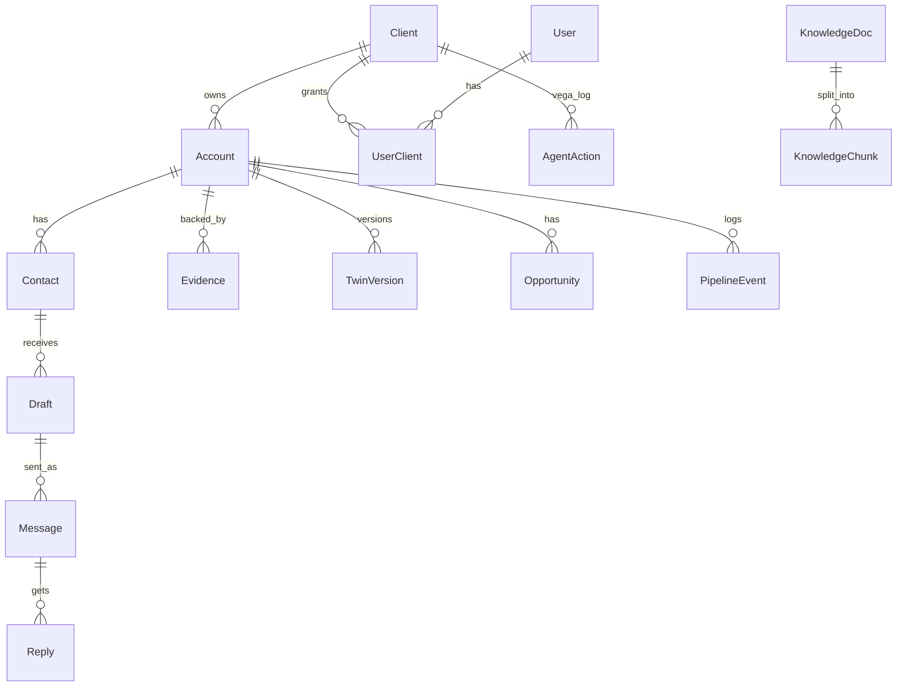
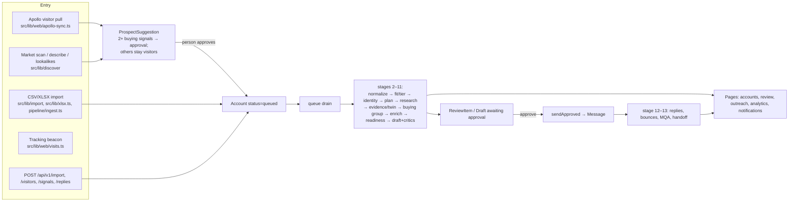

# 04 · Database and data flow

## Store [Code]
- PostgreSQL through Prisma. The schema is `prisma/schema.prisma` (about 1.8k lines, **70 models**), with 53 migrations in `prisma/migrations`.
- Production runs on a managed Postgres (Supabase). The project ID is redacted.
- The latest migration is `20261120090000_jarvis_foundation`, which adds the agent tables.
- **Pending:** the P0-1 "contract" migration (removes old columns after the expand step). It is deliberately not applied and needs owner approval. [Runtime]

## Models by domain [Code]
| Domain | Models |
|---|---|
| Tenancy and auth | Client, User, UserClient, SignInEvent, AuditEntry, RateLimit, IntegrationSetting, SavedView, SellerPackRevision, AgentSetting |
| CRM core | **Account** (`sellerId` → Client, `mergedIntoId`, pipeline stage/status/retries), Contact, Opportunity, Task, Note, Handoff, Decision, Proposal |
| Research | FieldState, Evidence, EvidenceLink, Hypothesis, ResearchRun, ResearchQuery, ResearchPlan, TwinVersion, AccountBrief, BrainInsight, BrainSignal, CompanyFinancial, FundingRound, TechUse, SearchCache |
| Outreach | Sequence, SequenceStep, Enrollment, Draft, Message, Reply, Suppression, Mailbox, SenderProfile, Campaign, Journey, JourneyEvent, LinkedInMessage |
| Signals and discovery | Signal, WebVisit, VisitorEnrichment, MarketEvent, ProspectSuggestion, DiscoverySearch, CareersFeed, DailyRecommendation |
| Ops | PipelineEvent, ReviewItem, WatchlistEntry, LedgerEntry, ImportBatch, JobLease, BackgroundJob, ErrorLog, RunLog |
| Knowledge | KnowledgeDoc, KnowledgeChunk (embeddings) |
| Assistant and agent | AssistantConversation, AssistantMessage, AssistantSavedQuestion, AgentAction, AgentEvent |

Tenancy key: an account belongs to a client through `Account.sellerId`. Most other rows reach the client through their account (`scopeWhere` in `src/lib/scope.ts`).

## How data enters, changes and reaches the screen [Code]

- **Visitor rule:** `MIN_VISITOR_SIGNALS = 2` in `src/lib/discover/visitors.ts`. A visitor company needs at least two of these to be suggested for approval:
  - repeat visits on different days;
  - pricing, demo or contact pages;
  - several topics;
  - a matching market event.
- **Facts carry provenance:** `Evidence` stores the source URL, date and confidence. `FieldState` holds per-field values.
- **Spend:** `LedgerEntry` records every paid call.

## Live data observations (read-only queries) [Runtime]
- On 15 Nov a Super Admin "clear account data" action removed Client A's companies and visitor suggestions. 289 raw visits remain.
- AI has been paused since 20 Nov, so about 410 companies are queued and waiting for research.
- The live RunLog shows only the daily "core" step.
