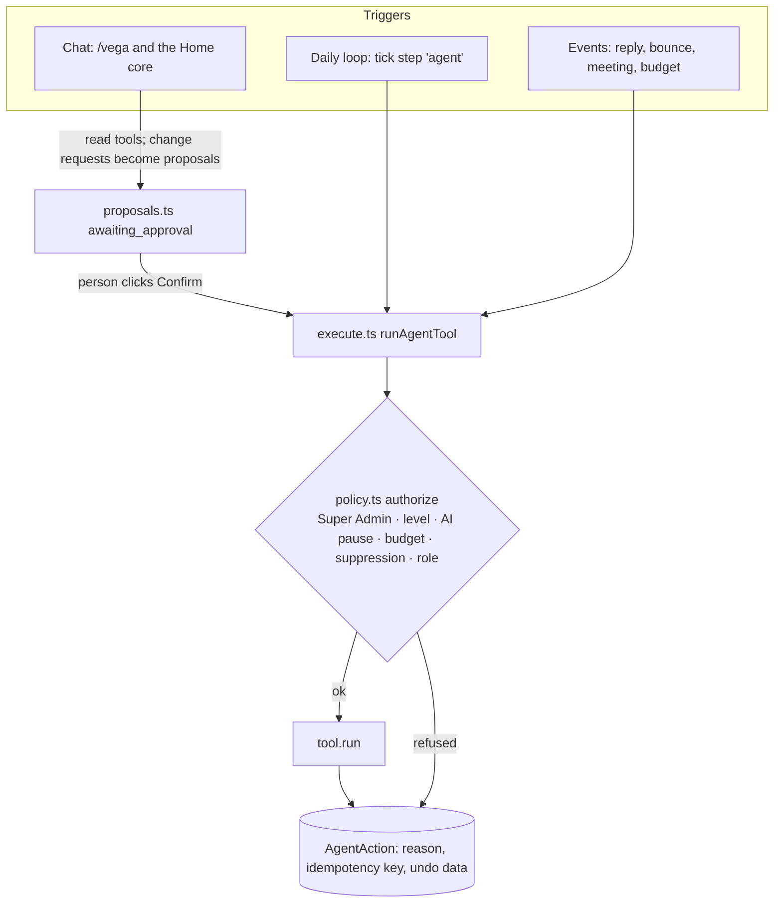

# 06 · AI, agents and intelligence

## Models [Code]
All models are called through OpenRouter. Wiring is in `src/lib/adapters/index.ts`; each default can be overridden by env.

| Role | Default | Env |
|---|---|---|
| Extraction, checks, classification | `openai/gpt-4o-mini` | `LLM_MODEL` |
| Validator | the general model | `VALIDATOR_MODEL` |
| Email writer | `anthropic/claude-sonnet-4.5` | `WRITER_MODEL` |
| Embeddings | `openai/text-embedding-3-small` | `EMBED_MODEL` |
| Vega chat and admin assistant | gpt-4o-mini | `ASSISTANT_MODEL` |

**[Verify]** The models actually configured in production; the environment couldn't be read.

## Prompts (`src/lib/adapters/live/openrouter.ts`, one system prompt per method) [Code]
| Purpose | Methods |
|---|---|
| Research | extractEvidence, infer, investigate, connectEvidence, planResearch, accountBrief, extractFirmographics, extractMarketEvents |
| Discovery and qualification | parseDiscoveryBrief, extractCompaniesForBrief, extractSimilarCompanies, profileCompany, planLookalike, extractLookalikeFacts, proposeInfluencers, classifyTitle |
| Drafting | draft (writer model), draftLinkedIn, briefing |
| Critics | critiqueDraft, auditEmail, validateResearch, checkClaims |
| Replies | classifyReply, classifyJourneyReply, analyzeLinkedInReply, summarizeConversation |
| Insights | insights |

## Safeguards and validation [Code]
- **Structured output:** every response is parsed as JSON and validated with zod; invalid output gets one retry.
- **Sources and compliance stay in code:** source URLs come from fetched pages, never from the model. Compliance lines are appended by code.
- **Prompt-injection fence** (`src/lib/llm/fence.ts`):
  - `fenceUntrusted` wraps web pages, replies and pasted text in a strict data block.
  - `UNTRUSTED_RULE` tells the model to treat anything inside it as data, not instructions.
  - **Only about 3 call sites use it [Verify that coverage is complete].**
- **Research checks:**
  - precision rules (`src/lib/research/precision.ts`): tiers, event date, entity match, duplicates, contradictions, confidence;
  - freshness (`src/lib/pipeline/freshness.ts`);
  - gates (`src/lib/pipeline/gates.ts`).
- **Draft review:**
  - a critic panel (facts, compliance, style) with guided rewrites;
  - a "Why this email" box shows the facts each draft cites.
- **Feedback:** a fact marked wrong is withdrawn at once, and so are any unsent drafts that cite it (`src/lib/brain/feedback.ts`).
- **Quality benchmark:** `npm run bench` (`benchmarks/`) is a manual labelled benchmark, not run in CI.

## Scoring systems [Code]
- Intent: `src/lib/brain/intent.ts` (`scoreIntent`, `readIntent`)
- Fit and tier: `src/lib/pipeline/scoring.ts`, `src/lib/seller/fit.ts`, `src/lib/tier-label.ts`
- Readiness: pipeline stage 10
- Lookalike similarity, 0–100: `src/lib/discover/similarity.ts`
- Why-now text: `src/lib/why-now.ts`
- Priority, relevance and completeness: `src/lib/brain/*`
- Visitor buying signals: `visitorSignals`
- Draft strength: `scoreDraft` in `src/lib/agent/approvals.ts`

## Learning [Code]
- Emails that get a positive reply become knowledge-base examples (`src/lib/knowledge/rag/learn.ts`).
- Reviewer edits and rejections feed drafting rules (tests: `tests/learn-from-review.test.ts`).
- Seller-profile edits are tracked as diffs (`src/lib/seller/diff.ts`).
- RAG retrieval: `src/lib/knowledge/rag/*`, with chunking, embeddings and retrieval for each message.

## Vega, the agent engine (`src/lib/agent/*`) [Code]

- **Level 0 (read-only):** about 22 read tools (`registry.ts`), each fact labelled verified, inferred, stale or outdated.
- **Level 1 (acts on its own):** rescore, refresh research, prepare drafts, follow-up task, plus find people (on request).
  - Runs within a daily cap and once-a-day keys.
  - Reversible actions store what Undo needs.
  - Decided by rules, with no LLM call (`actions-l1.ts`, `loop.ts`).
- **Level 2 (reacts, then tells you):** opt-out everywhere (cannot be undone), hot-reply handoff, question task, out-of-office reschedule, find a replacement, meeting prep, budget brake.
  - Shown as "Vega:" notices (`actions-l2.ts`, `events.ts`).
- **Level 3 (recommends, a person decides):**
  - `recommended_approvals` scores drafts.
  - `approve_drafts` runs only from a confirmed proposal, for up to 25 drafts.
  - Agreement with people's decisions is tracked over time (`approvals.ts`, `actions-l3.ts`).
- **Chat that acts:**
  - Changing requests become Confirm/Dismiss cards.
  - A proposal can be confirmed only once, within 24 hours.
  - Outcomes are reported honestly (`proposals.ts`, `chat.ts`).
- **Hard limits:**
  - No send or reject tool exists.
  - Users must be Super Admins.
  - Every action goes through one policy gate and is logged.

**Super Admin assistant** (`src/lib/assistant/*`): a separate read-only Q&A helper with zod-checked steps, limited to 14 facts and 20 references.
