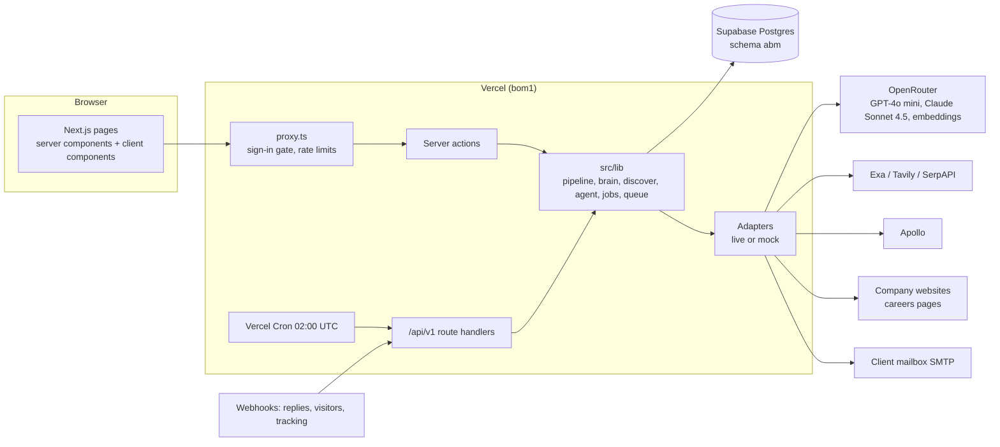
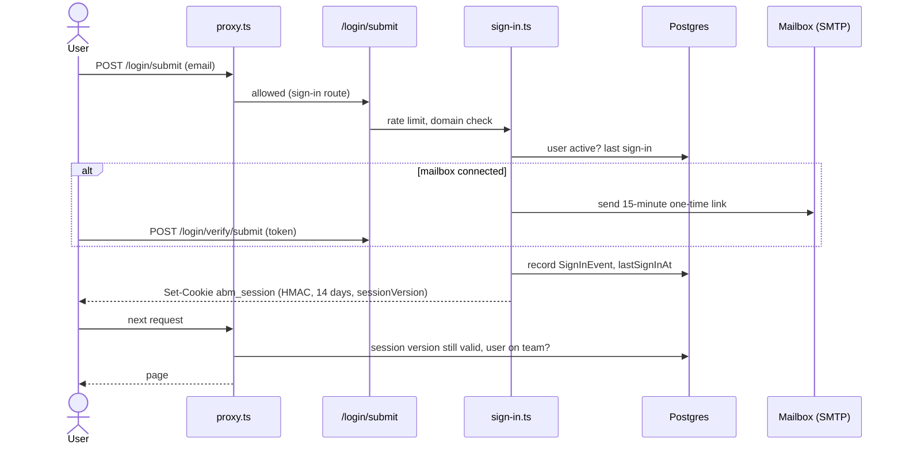
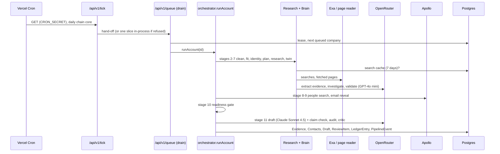
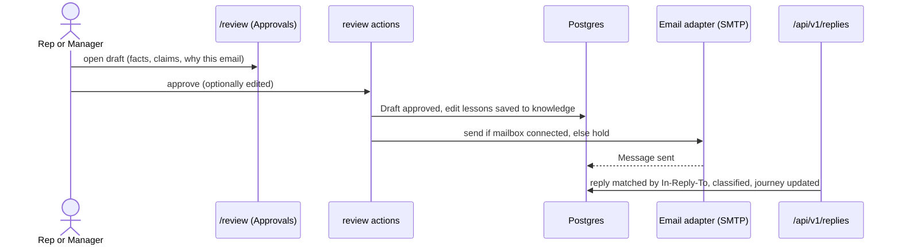

# ABM Intelligence: Project Brief

Generated on 2026-11-25 from the repository at `/home/user/ABM` (branch `feature/website-visitors`, based on production commit `290a16d`). Every claim cites a file path. "Not found" means the repository does not contain it. No secrets are included; environment variables are named only.

> **Important correction to the brief's template:** this repository contains **no Flutter or Dart code** (no `pubspec.yaml`, no `lib/`). ABM is a single **Next.js 16 / React 19 / TypeScript** web application with a PostgreSQL database. Section 2 therefore describes the actual web frontend and marks the Flutter-specific items as not found.

---

## 1. Project overview

### What ABM does

ABM Intelligence is an account-based marketing and outbound-sales platform for B2B sellers (`README.md`). It takes target companies, researches them with sourced evidence, finds the buying group, drafts fact-checked outreach that a person approves, and tracks engagement, all per client (a "client" is a seller company using the platform).

- 13-stage pipeline: raw accounts → clean → fit/tier/exclusions → identity → research plan → research → evidence twin → buying group → enrichment → readiness gate → draft and review → sequences → sales handoff (`README.md`, `src/lib/pipeline/orchestrator.ts`, `src/lib/pipeline/stages/`).
- Daily prospecting ("Recommended today"): news scan, careers-page job feeds, re-checks, lookalikes (`src/lib/discover/daily.ts`, `src/lib/discover/scan.ts`, `src/lib/discover/recommend.ts`).
- Website visitors from Apollo and a first-party tracking script (`src/lib/web/apollo-sync.ts`, `src/app/api/v1/track/route.ts`, `src/app/import/apollo/page.tsx`).
- Vega, an assistant that answers from evidence and turns changing actions into proposals a person confirms (`src/lib/agent/chat.ts`, `src/app/vega/`).
- A built-in CRM: accounts, contacts, opportunities, tasks, notes (`src/app/crm/`).
- Multi-client administration: Super Admin, per-client roles, audit log, budgets (`src/app/team/`, `src/lib/scope.ts`, `src/lib/roles.ts`, `src/lib/budget.ts`).

### Users

- Client team members with roles **owner, manager, rep, viewer** (`src/lib/roles.ts:5`).
- **Super Admins**, who may cover all clients or a list of clients (`prisma/schema.prisma`, model `User`, fields `superAdmin`, `superAdminClients`).
- Machine users: cron and webhooks calling `/api/v1` with bearer keys (`src/lib/api.ts`, `src/lib/api-clients.ts`).

### Main user flows

1. Sign in with a work email on an allowed domain (`src/app/login/`, `src/lib/sign-in.ts`, `src/lib/auth.ts`).
2. Set up the client's Account Brain (seller pack: offering, ideal customer, triggers, personas, writing knowledge) (`src/app/settings/seller/`, `src/lib/seller/`).
3. Bring in companies: CSV upload, describe-your-customer search, lookalikes, Apollo website visitors, daily recommendations (`src/app/import/`, `src/app/discover/`).
4. The pipeline researches each company in the background (`src/lib/queue/drain.ts`, `src/app/api/v1/queue/route.ts`).
5. Review and approve drafts and other decisions in Approvals (`src/app/review/page.tsx`).
6. Send through the connected mailbox; replies come back by webhook (`src/lib/adapters/live/email.ts`, `src/app/api/v1/replies/route.ts`).
7. Work the account in the company page, CRM and handoffs (`src/app/accounts/[id]/`, `src/app/handoffs/`).

### Repository layout (single repository, not a monorepo)

| Path | Purpose |
| --- | --- |
| `src/app/` | Next.js App Router: pages, server actions (`actions.ts` files, 18 marked `"use server"`), route handlers |
| `src/components/` | Shared React components; `src/components/kit/` is the design-system kit |
| `src/lib/` | All business logic: pipeline, research, brain, seller packs, discovery, adapters, auth, scope, jobs, queue |
| `src/lib/adapters/` | Interfaces to external services with deterministic mocks (`mock.ts`) and live implementations (`live/`) |
| `src/proxy.ts` | Request gate (Next 16 "proxy", the former middleware): sign-in, server-action blocking, API rate limits |
| `src/instrumentation.ts` | Startup hook (loads integration keys) |
| `prisma/` | `schema.prisma`, 56 migrations, `seed.ts` |
| `tests/` | 90 entries: Vitest integration and unit tests, `tests/e2e/` browser journeys |
| `scripts/` | Build gate, prebuild, token linter, backup and verify scripts, pipeline runner, benchmarks |
| `docs/` | Plan, design system, Brain, integrations, journeys, Stage B runbook, spreadsheets |
| `ABM_KNOWLEDGE_TRANSFER/` | Redacted knowledge-transfer package |
| `benchmarks/`, `shots/` | Benchmark outputs and screenshots |
| `.github/workflows/checks.yml` | CI |
| `vercel.json` | Hosting config: region `bom1`, daily cron |

### Tech stack (from `package.json`)

| Layer | Technology and version |
| --- | --- |
| Runtime | Node.js >= 20 (`package.json` engines); CI uses Node 22 (`.github/workflows/checks.yml`) |
| Framework | Next.js ^16.3.8 (App Router, server actions, route handlers), React ^19.3.0 |
| Language | TypeScript ^5.9.3 |
| Styling | Tailwind CSS ^4.3.3, design tokens in `src/app/design.css` and `globals.css`, Geist and other fonts |
| Database | PostgreSQL (Supabase Postgres 17 in production; PostgreSQL 16 locally per `README.md`), Prisma ^6.19.3 |
| Validation | Zod ^4.6.5 |
| Charts | Recharts ^3.10.1 |
| Files | papaparse (CSV), jszip and an in-house XLSX writer (`src/lib/xlsx.ts`), mammoth (DOCX), unpdf (PDF) |
| Email | nodemailer ^7 (SMTP) |
| Tests | Vitest ^3.2.7, Playwright (browser journeys, pre-installed in CI image) |
| Hosting | Vercel (project `abm`, region `bom1`, Hobby plan), Supabase (Free plan) |
| AI and data | OpenRouter (GPT-4o mini default, Claude Sonnet 4.5 writer, text-embedding-3-small), Exa / Tavily / SerpAPI search, Apollo, optional BuiltWith |

### Local setup, run and build

Tools: Node.js 20+, npm, PostgreSQL 16+ (`README.md`).

```bash
createdb abm && createdb abm_test        # two databases (README.md)
cp .env.example .env                     # then set DATABASE_URL
npm install                              # runs prisma generate (postinstall)
npx prisma migrate deploy && npm run db:seed
npm run dev                              # http://localhost:3000
npm test                                 # Vitest against abm_test
npm run test:e2e                         # browser journeys
npm run build                            # prebuild + gate + next build
```

Scripts are defined in `package.json` (`dev`, `build`, `lint` = `tsc --noEmit`, `test`, `test:unit`, `test:e2e`, `db:migrate`, `db:deploy`, `db:seed`, `db:reset`, `pipeline:run`, `lint:tokens`, `bench`, `db:sync`).

Environment variable names found in code (`src/`, `prisma/`, `scripts/`):

| Group | Names |
| --- | --- |
| Core | `DATABASE_URL`, `TEST_DATABASE_URL`, `APP_URL`, `APP_TIMEZONE`, `APP_USER_NAME`, `NODE_ENV`, `NEXT_RUNTIME` |
| Auth and security | `AUTH_SECRET`, `AUTH_REQUIRED`, `AUTH_EMAIL_DOMAINS`, `AUTH_LINK_REQUIRED`, `ABM_API_KEY`, `ABM_API_OPEN`, `CRON_SECRET`, `WEBHOOK_SECRET`, `TRACK_SECRET`, `TRACK_ORIGINS`, `VERCEL_AUTOMATION_BYPASS_SECRET` |
| AI | `OPENROUTER_API_KEY`, `OPENROUTER_BASE_URL`, `LLM_MODEL`, `VALIDATOR_MODEL`, `WRITER_MODEL`, `EMBED_MODEL`, `ASSISTANT_MODEL` |
| Data providers | `EXA_API_KEY`, `TAVILY_API_KEY`, `SERPAPI_API_KEY`, `APOLLO_API_KEY`, `APOLLO_VISITOR_LIST`, `APOLLO_VISITOR_LABEL_ID`, `APOLLO_VISITOR_SITE`, `BUILTWITH_API_KEY` |
| Email | `SMTP_URL`, `SMTP_FROM` |
| Behaviour | `ACTIVE_SELLER`, `ADAPTER_MODE`, `ENFORCE_BUDGETS`, `QUEUE_SLICE_MS`, `ALLOW_SEED`, `GATE_SKIP`, `ABM_TEST_COPY`, `TEST_DEFAULT_CLIENT` |
| Platform (set by Vercel) | `VERCEL_ENV`, `VERCEL_PROJECT_PRODUCTION_URL`, `VITEST` |

Integration keys can also be saved in the app (Admin → Integrations), encrypted with `AUTH_SECRET`, and copied into the process environment by `syncIntegrationEnv()` (`src/lib/integration-keys.ts`, model `IntegrationSetting`).

---

## 2. Frontend

### Flutter-specific items

| Requested item | Finding |
| --- | --- |
| Flutter and Dart versions | Not found (no Flutter project) |
| `lib/` structure, state management (Provider, Riverpod, Bloc, GetX) | Not found |
| `pubspec.yaml` dependencies | Not found |
| Android, iOS, push notifications, deep links, flavors | Not found. The app is a responsive web app; no native shells |

### Actual frontend: Next.js App Router

- **Architecture:** feature-first folders under `src/app/` (one folder per area), React Server Components for data reading, server actions for writes (`src/app/**/actions.ts`), a small number of client components for interactivity. Business logic lives in `src/lib/`, not in pages.
- **State:** no client state library. Server state is read in server components through Prisma (`src/lib/db.ts`); forms post to server actions; `useActionState`-style helpers and URL search params carry filters. Per-user preferences are stored in `User.prefs` (`src/lib/prefs.ts`).
- **Data scoping:** every database read and write goes through a scoped Prisma client that filters by the signed-in person's clients (`src/lib/db.ts`, `src/lib/scope.ts`, `scopeWhere()`).
- **Routing:** file-based. Screens (from `src/app/**/page.tsx`):

| Area | Routes |
| --- | --- |
| Home and work | `/`, `/overview`, `/work`, `/work/today` |
| Companies and people | `/companies`, `/accounts`, `/accounts/[id]`, `/accounts/coverage`, `/people`, `/people/[id]` |
| Prospecting | `/discover`, `/import`, `/import/upload`, `/import/describe`, `/import/lookalikes`, `/import/apollo`, `/signals` |
| Engagement | `/review` (Approvals), `/outreach`, `/handoffs`, `/pipeline` |
| CRM | `/crm`, `/crm/contacts`, `/crm/opportunities`, `/crm/tasks` |
| Brain and settings | `/brain`, `/settings`, `/settings/seller`, `/settings/seller/edit`, `/settings/knowledge` |
| Assistant and insights | `/vega`, `/analytics` |
| Admin | `/admin`, `/admin/integrations`, `/team`, `/team/client/[id]`, `/clients` |
| Account | `/login`, `/login/verify`, `/me` |
| Internal | `/kit` (component gallery) |

- Navigation and role-aware menus: `src/lib/nav.ts`.
- **Components and theming:** design-system kit in `src/components/kit/` (index in `src/components/kit/index.ts`), tokens in `src/app/design.css` and `src/app/globals.css`, enforced by `scripts/check-tokens.mjs`. Light and dark themes. Design rules in `docs/DESIGN.md`.
- **Localization:** not found (English only). Dates and times use `APP_TIMEZONE` / Asia/Kolkata in places.
- **Networking:** there is no client-side HTTP layer; the browser talks to server actions and a few route handlers (`/api/jobs/mine`, `/search`). Outbound calls to providers happen on the server through `src/lib/adapters/live/http.ts` (`fetchJson`: timeouts, retries after 1 s and 3 s on 429, 5xx and network errors, honouring Retry-After).
- **Auth on the client:** an HTTP-only, HMAC-signed session cookie `abm_session` (`src/lib/auth.ts:4`); no tokens in browser storage.
- **Local storage and offline:** no offline mode. A few UI conveniences may use browser storage; not a data store.
- **Errors:** `src/app/error.tsx`, `not-found.tsx`, `loading.tsx`, and per-section error screens with Try again.

---

## 3. Backend

### Language, framework, entry points

The backend is the same Next.js 16 application (TypeScript), deployed as Vercel serverless functions in region `bom1` (`vercel.json`). Entry points:

- **Server actions** in `src/app/**/actions.ts`: all writes from the UI.
- **Route handlers** in `src/app/**/route.ts`: the public and machine API under `/api/v1`, exports and sign-in.
- **Scheduler:** Vercel Cron calls `GET /api/v1/tick` daily at 02:00 UTC (`vercel.json`), which runs the daily chain core → intel → intent → market → agent (`src/app/api/v1/tick/route.ts`, `src/lib/pipeline/daily-chain.ts`).
- **Request gate:** `src/proxy.ts` runs before every request.

### API list

Auth key: **Session** = signed-in cookie through `src/proxy.ts`; **API key** = `Authorization: Bearer` `ABM_API_KEY` checked by `authorize()` (`src/lib/api.ts:34`); **Client key** = a per-client key (hashed, created by a Super Admin) or the workspace key with `x-client-id`, checked by `authorizeClient()` (`src/lib/api-clients.ts:60`); **Cron** = `CRON_SECRET` bearer. All `/api/v1` calls are rate-limited to 300 per minute per address (`src/lib/rate-limit.ts:41`). Request bodies are validated with Zod through `parseBody()` (`src/lib/api.ts:55`); exact shapes are in each route file.

| Method | Path | Purpose | Auth | File |
| --- | --- | --- | --- | --- |
| GET | `/api/v1/health` | Liveness: database reachable or not | Public | `src/app/api/v1/health/route.ts` |
| GET, POST | `/api/v1/tick` | Daily heartbeat and chain steps | Cron or API key | `src/app/api/v1/tick/route.ts` |
| GET, POST | `/api/v1/queue` | Background research queue status / drain slice (answers 202) | Cron or API key | `src/app/api/v1/queue/route.ts` |
| POST | `/api/v1/jobs` | Runs one background job after replying 202 | Cron or API key | `src/app/api/v1/jobs/route.ts` |
| GET, POST | `/api/v1/agent/loop` | Vega Level 1 pass for clients that enabled it | Cron or API key | `src/app/api/v1/agent/loop/route.ts` |
| POST | `/api/v1/pipeline/run` | Run the pipeline for given accounts | API key | `src/app/api/v1/pipeline/run/route.ts` |
| GET, POST | `/api/v1/accounts` | List or create one client's companies | Client key | `src/app/api/v1/accounts/route.ts` |
| GET | `/api/v1/accounts/[id]` | One company with its research | API key | `src/app/api/v1/accounts/[id]/route.ts` |
| GET | `/api/v1/contacts` | Contacts | API key | `src/app/api/v1/contacts/route.ts` |
| POST | `/api/v1/import` | CSV import (same rules as the UI) | Client key | `src/app/api/v1/import/route.ts` |
| POST | `/api/v1/replies` | Inbound email replies (matched by In-Reply-To / References) | Client key, optional signature | `src/app/api/v1/replies/route.ts` |
| POST | `/api/v1/signals` | Tracking, intent and email-provider events | Client key | `src/app/api/v1/signals/route.ts` |
| POST | `/api/v1/visitors` | Reverse-IP visitor tools (Leadfeeder, Albacross, RB2B) | Client key | `src/app/api/v1/visitors/route.ts` |
| POST | `/api/v1/track` | First-party tracking script events | Public, origin-limited (`TRACK_ORIGINS`, `TRACK_SECRET`) | `src/app/api/v1/track/route.ts` |
| GET | `/api/v1/track/script` | The tracking snippet | Public | `src/app/api/v1/track/script/route.ts` |
| POST | `/api/v1/gdpr/erase` | Right-to-erasure by email (hashed suppression) | API key | `src/app/api/v1/gdpr/erase/route.ts` |
| POST | `/api/v1/admin/seed` | Demo seeding (destructive) | API key + `ALLOW_SEED` | `src/app/api/v1/admin/seed/route.ts` |
| GET | `/api/jobs/mine` | The signed-in person's jobs (top-bar indicator) | Session | `src/app/api/jobs/mine/route.ts` |
| GET | `/search` | Global search | Session | `src/app/search/route.ts` |
| POST | `/login/submit`, `/login/verify/submit` | Sign-in and emailed-link confirmation | Public, rate-limited 10 per 15 min | `src/app/login/` |
| GET | `/accounts/export`, `/people/export`, `/import/apollo/export`, `/import/template`, `/team/audit.csv`, `/team/client/[id]/export` | CSV and XLSX exports | Session and role | listed paths under `src/app/` |

Webhook signatures (optional, `WEBHOOK_SECRET`): `src/lib/webhook-signature.ts`.

### Authentication and authorization

- **Sign-in:** work email on an allowed domain (`AUTH_EMAIL_DOMAINS`); when a mailbox is connected, a one-time emailed link valid 15 minutes (`src/lib/auth.ts:76-81`, `src/lib/sign-in.ts`).
- **Session:** HMAC-SHA256 signed cookie `abm_session`, 14 days (`src/lib/auth.ts:4-5,83`), carrying a `sessionVersion` so "sign out everywhere" and removal revoke it; checked against the database on every request (`src/proxy.ts`, `src/lib/session.ts`).
- **Signed-out visitors** can reach only the sign-in pages and the two sign-in routes; any server-action post is refused with 401 (`src/proxy.ts`).
- **Roles:** owner > manager > rep > viewer per client (`src/lib/roles.ts`), the minimum role per action from `minRoleFor()`; denials logged as `denied.<action>` (`src/lib/client-access.ts`, model `AuditEntry`).
- **Super Admin:** full or limited to listed clients (`User.superAdmin`, `User.superAdminClients`); "Super Admin mode" toggle.
- **Data isolation:** `scopeWhere()` filters every model by client (`src/lib/scope.ts`).

### Business logic, jobs and schedulers

| Area | Where |
| --- | --- |
| Pipeline orchestration (stages 2–11, retries, locks) | `src/lib/pipeline/orchestrator.ts`, `src/lib/pipeline/stages/` |
| Research and the Brain (plan, investigate, validate, brief) | `src/lib/research/`, `src/lib/brain/`, `src/lib/profile/` |
| Seller packs (Account Brain) and validation | `src/lib/seller/` (`schema.ts`, `brain.ts`, `manch.ts`) |
| Buying group and contacts | `src/lib/buying-group/`, `src/lib/people.ts` |
| Outreach, sequences, LinkedIn | `src/lib/outreach/`, `src/lib/linkedin/`, `src/lib/journey/` |
| Discovery and daily prospecting | `src/lib/discover/` |
| Website visitors | `src/lib/web/` |
| Vega agent and assistant | `src/lib/agent/`, `src/lib/assistant/` |
| Background jobs (long buttons) | `src/lib/jobs/index.ts` (kinds: run_account, research_question, profile_refresh, scan_market, daily_run, lookalikes, discovery_draft, discovery_run, apollo_fetch, reindex) |
| Queue with lease | `src/lib/queue/drain.ts`, model `JobLease` |
| Daily chain and hand-offs | `src/lib/pipeline/daily-chain.ts`, `src/lib/pipeline/handoff.ts` |
| Budgets and cost ledger | `src/lib/budget.ts`, `src/lib/pipeline/context.ts`, model `LedgerEntry` |
| Knowledge base (RAG) | `src/lib/knowledge/`, models `KnowledgeDoc`, `KnowledgeChunk` |
| Import | `src/lib/import/` |

### Third-party integrations

| Integration | Use | Where | Status |
| --- | --- | --- | --- |
| OpenRouter | All LLM calls and embeddings | `src/lib/adapters/live/openrouter.ts`, `embeddings.ts`, `src/lib/agent/chat.ts` | Active; AI paused in production since about 20 Nov 2026 |
| Exa, Tavily, SerpAPI | Web search for research | `src/lib/adapters/live/research.ts` | Exa active; others implemented, unused |
| Direct page reader | Fetch pages, robots.txt respected | `src/lib/adapters/live/reader.ts` | Active |
| Apollo | Visitor list, visit dates, people search, email reveal, org enrichment | `src/lib/adapters/live/apollo.ts` | Active (one global key) |
| BuiltWith | Tech stack | `src/lib/profile/builtwith.ts` | Implemented, no key |
| SMTP | Sending email | `src/lib/adapters/live/email.ts` | Implemented, not connected (0 emails sent) |
| MX check | Email domain verification | `src/lib/adapters/index.ts` (`MxVerifier`) | Active, free |
| Payments, maps, SMS, analytics, file storage | | | Not found |

### Validation, errors, logging, rate limiting

- Validation: Zod everywhere (API bodies, AI output, seller packs) (`src/lib/api.ts`, `src/lib/seller/schema.ts`, `src/lib/adapters/live/openrouter.ts`).
- Errors: `recordError()` writes to model `ErrorLog` (`src/lib/admin/errors.ts:13`), shown on System health.
- Logging: every pipeline decision to `PipelineEvent` with a reason; scheduler runs to `RunLog`; audit actions to `AuditEntry`.
- Rate limiting: database-backed (`RateLimit` model), login 10 per 15 minutes, API 300 per minute (`src/lib/rate-limit.ts`).

### Configuration and environments

- One production environment on Vercel (deploys on every push to `claude/clever-noether-kff67l`); Vercel preview deployments for other branches. A separate staging environment: not found.
- Business configuration in `src/lib/config.ts` (tiers, research rounds, budgets, cost assumptions, cache days).
- Secrets: Vercel environment variables, or saved encrypted in `IntegrationSetting`. `.env.example` lists local variables.
- Mock mode: `ADAPTER_MODE=mock` swaps every external service for deterministic mocks (`src/lib/adapters/mock.ts`).

---

## 4. Database

### Engine and hosting

PostgreSQL through Prisma (`prisma/schema.prisma`, `provider = "postgresql"`, `DATABASE_URL`). Production: Supabase project `abm-intelligence`, Postgres 17, schema `abm`, Free plan, region ap-south-1, about 51 MB (measured 24 Nov 2026). CI and local tests: Postgres 17 service in CI (`.github/workflows/checks.yml`), Postgres 16 per `README.md`.

- 70 models, 24 enums, 53 foreign-key relations (generated from `prisma/schema.prisma`).
- 56 migrations in `prisma/migrations/`, from `20261005111306_init` to `20261123110000_account_domain_contract`.
- Seed: `prisma/seed.ts` and `src/lib/seed.ts` (runs sample data through the real pipeline).
- Row-level security, triggers and SQL functions: not found in migrations. Access control is enforced in the application (`src/lib/scope.ts`).
- Production migrations are applied manually through Supabase, then recorded in `_prisma_migrations` (`docs/STAGE-B-RUNBOOK.md`).

### Backup, retention and scaling

- Backups: Supabase Free has no paid backups; manual scripts `scripts/backup-abm.sh` and `scripts/verify-backup.sh` exist; an in-database copy `abm_backup_20261123` was made for Stage B.
- Retention: `RunLog` is pruned (`src/lib/admin/ops.ts`); other logs grow without pruning (not found). Search cache entries live 7 days (`searchCacheDays` in `src/lib/config.ts`).
- Scaling: research stores about 2–3 MB per researched company (`ResearchQuery`, `SearchCache`, `PipelineEvent` are the largest tables). Free plan limit 500 MB ≈ 170–250 researched companies.

### Relationships

Key relationships: a **Client** owns Accounts, ImportBatches, campaigns and visits through `sellerId`; an **Account** has Contacts, Evidence, Signals, ResearchRuns, Opportunities, Tasks, Notes and LedgerEntries (mostly `onDelete: Cascade`); a **Contact** has Enrollments, Drafts, Messages, Replies and Journeys; **User** links to clients through **UserClient** (role per client). Several client links are plain `sellerId` strings rather than foreign keys.

Entity-relationship diagram (every declared foreign key):

```mermaid
erDiagram
  User ||--o{ Account : "owner"
  Account ||--o{ Contact : "account"
  Account ||--o{ Opportunity : "account"
  User ||--o{ Opportunity : "owner"
  Account ||--o{ Task : "account"
  Contact ||--o{ Task : "contact"
  User ||--o{ Task : "assignee"
  Account ||--o{ Note : "account"
  Contact ||--o{ Note : "contact"
  User ||--o{ Note : "author"
  Account ||--o{ FieldState : "account"
  Contact ||--o{ FieldState : "contact"
  Account ||--o{ Evidence : "account"
  Account ||--o{ TwinVersion : "account"
  Account ||--o{ ResearchQuery : "account"
  Account ||--o{ AccountBrief : "account"
  Account ||--o{ ResearchPlan : "account"
  Account ||--o{ Signal : "account"
  Contact ||--o{ Signal : "contact"
  Sequence ||--o{ SequenceStep : "sequence"
  Contact ||--o{ Enrollment : "contact"
  Sequence ||--o{ Enrollment : "sequence"
  Contact ||--o{ Draft : "contact"
  Draft ||--o{ Message : "draft"
  Contact ||--o{ Message : "contact"
  Message ||--o{ Reply : "message"
  Contact ||--o{ Reply : "contact"
  Account ||--o{ PipelineEvent : "account"
  Account ||--o{ ReviewItem : "account"
  Contact ||--o{ ReviewItem : "contact"
  Account ||--o{ WatchlistEntry : "account"
  Account ||--o{ LedgerEntry : "account"
  Account ||--o{ Handoff : "account"
  User ||--o{ Handoff : "owner"
  Campaign ||--o{ ImportBatch : "campaign"
  SenderProfile ||--o{ ImportBatch : "sender"
  Contact ||--o{ Journey : "contact"
  Campaign ||--o{ Journey : "campaign"
  SenderProfile ||--o{ Journey : "sender"
  Journey ||--o{ JourneyEvent : "journey"
  KnowledgeDoc ||--o{ KnowledgeChunk : "doc"
  AssistantConversation ||--o{ AssistantMessage : "conversation"
  User ||--o{ UserClient : "user"
  Client ||--o{ UserClient : "client"
  Account ||--o{ ResearchRun : "account"
  Account ||--o{ Hypothesis : "account"
  ResearchRun ||--o{ Hypothesis : "researchRun"
  Account ||--o{ EvidenceLink : "account"
  Hypothesis ||--o{ EvidenceLink : "hypothesis"
  Account ||--o{ CompanyFinancial : "account"
  Account ||--o{ FundingRound : "account"
  Account ||--o{ TechUse : "account"
  Journey ||--o{ LinkedInMessage : "journey"
```



Foreign keys:

| From (child) | Field | To (parent) | Foreign key | On delete |
| --- | --- | --- | --- | --- |
| Account | owner | User | ownerId | default |
| Contact | account | Account | accountId | Cascade |
| Opportunity | account | Account | accountId | Cascade |
| Opportunity | owner | User | ownerId | default |
| Task | account | Account | accountId | Cascade |
| Task | contact | Contact | contactId | Cascade |
| Task | assignee | User | assigneeId | default |
| Note | account | Account | accountId | Cascade |
| Note | contact | Contact | contactId | Cascade |
| Note | author | User | authorId | default |
| FieldState | account | Account | accountId | Cascade |
| FieldState | contact | Contact | contactId | Cascade |
| Evidence | account | Account | accountId | Cascade |
| TwinVersion | account | Account | accountId | Cascade |
| ResearchQuery | account | Account | accountId | Cascade |
| AccountBrief | account | Account | accountId | Cascade |
| ResearchPlan | account | Account | accountId | Cascade |
| Signal | account | Account | accountId | Cascade |
| Signal | contact | Contact | contactId | SetNull |
| SequenceStep | sequence | Sequence | sequenceId | Cascade |
| Enrollment | contact | Contact | contactId | Cascade |
| Enrollment | sequence | Sequence | sequenceId | Cascade |
| Draft | contact | Contact | contactId | Cascade |
| Message | draft | Draft | draftId | Cascade |
| Message | contact | Contact | contactId | Cascade |
| Reply | message | Message | messageId | SetNull |
| Reply | contact | Contact | contactId | Cascade |
| PipelineEvent | account | Account | accountId | Cascade |
| ReviewItem | account | Account | accountId | Cascade |
| ReviewItem | contact | Contact | contactId | Cascade |
| WatchlistEntry | account | Account | accountId | Cascade |
| LedgerEntry | account | Account | accountId | Cascade |
| Handoff | account | Account | accountId | Cascade |
| Handoff | owner | User | ownerId | default |
| ImportBatch | campaign | Campaign | campaignId | SetNull |
| ImportBatch | sender | SenderProfile | senderId | SetNull |
| Journey | contact | Contact | contactId | Cascade |
| Journey | campaign | Campaign | campaignId | Cascade |
| Journey | sender | SenderProfile | senderId | Cascade |
| JourneyEvent | journey | Journey | journeyId | Cascade |
| KnowledgeChunk | doc | KnowledgeDoc | docId | Cascade |
| AssistantMessage | conversation | AssistantConversation | conversationId | Cascade |
| UserClient | user | User | userId | Cascade |
| UserClient | client | Client | clientId | Cascade |
| ResearchRun | account | Account | accountId | Cascade |
| Hypothesis | account | Account | accountId | Cascade |
| Hypothesis | researchRun | ResearchRun | researchRunId | SetNull |
| EvidenceLink | account | Account | accountId | Cascade |
| EvidenceLink | hypothesis | Hypothesis | hypothesisId | Cascade |
| CompanyFinancial | account | Account | accountId | Cascade |
| FundingRound | account | Account | accountId | Cascade |
| TechUse | account | Account | accountId | Cascade |
| LinkedInMessage | journey | Journey | journeyId | Cascade |

### Enums

| Enum | Values |
| --- | --- |
| FieldStatus | verified, probable, conflicting, stale, invalid, unknown |
| Relationship | prospect, customer, competitor, partner |
| Tier | T1, T2, T3 |
| BuyingStage | UNAWARE, AWARE, ENGAGED, MQA, OPPORTUNITY, CUSTOMER, WATCH, DISQUALIFIED, RECYCLED |
| Priority | high, medium, low |
| StakeholderType | executive, board_member, independent_director, adviser, investor |
| BuyingRole | decision_maker, champion, influencer, budget_owner, unknown |
| ContactState | new, selected, ready, in_sequence, paused, replied, handed_off, suppressed, do_not_contact |
| ReadinessOutcome | ready, targeted_re_research, watch, human_review, disqualified |
| DraftStatus | pending_review, approved, rejected, blocked, sent, needs_refresh |
| MessageStatus | queued, delivered, bounced, duplicate_skipped, failed |
| ReplyClass | positive, objection, not_now, unsubscribe, wrong_person, out_of_office, needs_human |
| Channel | email, linkedin, call, task |
| EnrollmentStatus | active, paused, completed, stopped |
| SignalType | email_open, email_click, email_reply, site_visit, pricing_visit, intent_surge, job_change, event_attended, content_download |
| ReviewType | identity_conflict, contradiction, draft_approval, guardrail_failed, budget_exceeded, no_usable_person, lawful_basis_missing, briefing_blocked, needs_human_reply, bounce_breaker, draft_refresh, retry_exhausted, possible_blocker, proposed_rejection, other |
| ReviewStatus | open, resolved, dismissed |
| WatchStatus | waiting, due, processed, cancelled |
| OppStage | discovery, qualification, proposal, negotiation, won, lost |
| TaskStatus | todo, in_progress, done, cancelled |
| EventOutcome | pass, block, info, error |
| LedgerKind | llm, lookup, verification, search |
| UserRole | admin, marketer, rep, reviewer |
| JourneyStage | not_contacted, connection_sent, connection_accepted, follow_up_sent, replied_neutral, details_requested, details_shared, interested, nurture, referred, not_interested, disqualified, call_scheduled, demo_scheduled, opportunity, closed_won, closed_lost |

### Every table

Generated from `prisma/schema.prisma`. Notes come from the schema's own comments.

#### User

| Column | Type | Keys and constraints | Note |
| --- | --- | --- | --- |
| prefs | Json? |  | Personal preferences: landing page, notification kinds, theme, dismissed hints. |
| id | String | @id @default(cuid()) |  |
| name | String |  |  |
| email | String | @unique |  |
| role | UserRole | @default(rep) |  |
| status | String | @default("active") | active = may sign in; removed = access withdrawn (history kept). |
| superAdmin | Boolean | @default(false) | Entitled to switch into Super Admin (team, clients, access). Switching never removes it. |
| superAdminClients | String[] | @default([]) | Which clients that Super Admin covers. Empty = every client (the original, full Super Admin). |
| createdAt | DateTime | @default(now()) |  |
| lastSignInAt | DateTime? |  | Last successful sign-in. |
| sessionVersion | Int | @default(0) | Bumped to sign this person out everywhere (sessions carry the version they were issued with). |
| clients | UserClient[] | relation |  |
| ownedAccounts | Account[] | relation |  |
| opportunities | Opportunity[] | relation |  |
| tasks | Task[] | relation |  |
| notes | Note[] | relation |  |
| handoffs | Handoff[] | relation |  |

#### Account

| Column | Type | Keys and constraints | Note |
| --- | --- | --- | --- |
| id | String | @id @default(cuid()) |  |
| sellerId | String |  | The seller this account is researched and contacted for (a seller pack id). A run never mixes sellers. |
| intentReading | Json? |  | Latest multi-signal intent reading: score, level, converging families, signals with evidence, why now. |
| priorityScore | Int? |  | Combined priority (0–100): intent, fit, value and timing, weighted by the seller pack. |
| priorityParts | Json? |  | The four parts behind priorityScore and their weights, for the "why this order" view. |
| name | String |  |  |
| domain | String? |  | The company's website. Unique per client (see @@unique below): two clients can each target the same company. |
| industry | String? |  |  |
| employees | Int? |  |  |
| country | String? |  |  |
| revenueUsd | BigInt? |  |  |
| technologies | String[] | @default([]) |  |
| linkedinUrl | String? |  | Company LinkedIn page (normalized) — second matching key after domain. |
| nameKey | String? |  | Normalized name (legal suffixes and punctuation removed) — third matching key. |
| city | String? |  |  |
| keywords | String[] | @default([]) | Products, capabilities, markets (import column "Keywords", ; separated). |
| companyNotes | String? |  | Import column "Company Notes" (team notes live in Note). |
| relationship | Relationship | @default(prospect) |  |
| doNotContact | Boolean | @default(false) |  |
| source | String | @default("manual") |  |
| tier | Tier? |  |  |
| tierLocked | Boolean | @default(false) | true when a person set the tier by hand; otherwise it follows the fit score. |
| stage | BuyingStage | @default(UNAWARE) |  |
| fitScore | Int? |  |  |
| fitReasons | String[] | @default([]) | Plain-language reasons behind fitScore, one per component (seller-aware). |
| useCase | String? |  | The seller use case to lead with (e.g. distributor_onboarding). |
| dataConfidence | Float? |  |  |
| researchPriority | Priority? |  |  |
| intentScore | Float | @default(0) |  |
| engagementScore | Float | @default(0) |  |
| scoredAt | DateTime? |  |  |
| pipelineStage | Int | @default(0) |  |
| pipelineStatus | String | @default("idle") |  |
| outreachPausedUntil | DateTime? |  | Automatic retries after temporary failures (rate limits, outages, timeouts). Company-wide outreach pause (a decision maker said not now, or an objection awaits  |
| outreachPauseReason | String? |  |  |
| retryCount | Int | @default(0) |  |
| nextRetryAt | DateTime? |  |  |
| lastError | String? |  |  |
| followupUsed | Boolean | @default(false) |  |
| reopenUsed | Boolean | @default(false) |  |
| disqualifyReason | String? |  |  |
| lastRunAt | DateTime? |  |  |
| queuedFromStage | Int? |  |  |
| lastImportBatchId | String? |  |  |
| ownerId | String? |  |  |
| owner | User? | relation via ownerId |  |
| addedBy | String? |  | Who brought the company in (email or "system"), how (csv \| lookalike \| discovery \| website_visitor \| market_scan \| manual \| api) and from what (file name, |
| addedVia | String? |  |  |
| originDetail | String? |  |  |
| approvedBy | String? |  | Who approved it into the pipeline (lookalike, discovery and market suggestions). |
| profileUpdatedAt | DateTime? |  | Company profile (financials, funding, technologies, board): when it was last researched and the health reading. |
| financialHealth | String? |  | profitable_growing \| profitable \| breakeven \| loss_making \| declining \| unknown, with the numbers behind it. |
| financialNote | String? |  |  |
| businessModel | String? |  | How the company goes to market, from research: a key from the seller's business models, with the evidence behind it. |
| mergedIntoId | String? |  |  |
| createdAt | DateTime | @default(now()) |  |
| updatedAt | DateTime | @updatedAt |  |
| contacts | Contact[] | relation |  |
| fieldStates | FieldState[] | relation |  |
| evidence | Evidence[] | relation |  |
| researchRuns | ResearchRun[] | relation |  |
| hypotheses | Hypothesis[] | relation |  |
| evidenceLinks | EvidenceLink[] | relation |  |
| twins | TwinVersion[] | relation |  |
| plans | ResearchPlan[] | relation |  |
| signals | Signal[] | relation |  |
| opportunities | Opportunity[] | relation |  |
| tasks | Task[] | relation |  |
| notes | Note[] | relation |  |
| events | PipelineEvent[] | relation |  |
| reviewItems | ReviewItem[] | relation |  |
| watchlist | WatchlistEntry[] | relation |  |
| ledger | LedgerEntry[] | relation |  |
| handoffs | Handoff[] | relation |  |
| searches | ResearchQuery[] | relation |  |
| briefs | AccountBrief[] | relation |  |
| financials | CompanyFinancial[] | relation |  |
| fundingRounds | FundingRound[] | relation |  |
| techUses | TechUse[] | relation |  |

Indexes and unique constraints: `@@index([stage])`, `@@index([createdAt])`, `@@index([tier])`, `@@index([linkedinUrl])`, `@@index([nameKey])`, `@@index([ownerId])`, `@@index([mergedIntoId])`, `@@index([pipelineStatus])`, `@@index([sellerId, pipelineStatus])`, `@@index([sellerId, stage])`, `@@unique([sellerId, domain])`

#### Contact

| Column | Type | Keys and constraints | Note |
| --- | --- | --- | --- |
| id | String | @id @default(cuid()) |  |
| accountId | String |  |  |
| account | Account | relation via accountId, onDelete Cascade |  |
| firstName | String? |  |  |
| lastName | String? |  |  |
| fullName | String |  |  |
| email | String? |  |  |
| phone | String? |  |  |
| linkedinUrl | String? |  |  |
| title | String? |  |  |
| titleNormalized | String? |  |  |
| function | String? |  |  |
| department | String? |  | As given in the import (the inferred function above is used for buying roles). |
| location | String? |  |  |
| personNotes | String? |  | Import column "Notes" (team notes live in Note). |
| seniority | String? |  |  |
| buyingRole | BuyingRole | @default(unknown) |  |
| stakeholderType | StakeholderType | @default(executive) | What kind of stakeholder: an employee (executive), or someone outside the org chart who still shapes the decision. |
| influenceReason | String? |  | Why this person matters to the decision (for influencers, board members and advisers), with the fact it rests on. |
| discoveredBy | String? |  | How the person was found: import \| provider \| research \| influencer_search \| board_research |
| planOrder | Int? |  | Company contact plan: order in the buying group, when this person's outreach may start, and why. |
| planStartAt | DateTime? |  |  |
| planReason | String? |  |  |
| identityConfidence | Float? |  |  |
| state | ContactState | @default(new) |  |
| readiness | ReadinessOutcome? |  |  |
| readinessReasons | String[] | @default([]) |  |
| lawfulBasis | String? |  |  |
| country | String? |  |  |
| source | String | @default("manual") |  |
| mergedIntoId | String? |  |  |
| createdAt | DateTime | @default(now()) |  |
| updatedAt | DateTime | @updatedAt |  |
| fieldStates | FieldState[] | relation |  |
| drafts | Draft[] | relation |  |
| messages | Message[] | relation |  |
| replies | Reply[] | relation |  |
| signals | Signal[] | relation |  |
| enrollments | Enrollment[] | relation |  |
| tasks | Task[] | relation |  |
| notes | Note[] | relation |  |
| reviewItems | ReviewItem[] | relation |  |
| journeys | Journey[] | relation |  |

Indexes and unique constraints: `@@index([accountId])`, `@@index([email])`, `@@index([linkedinUrl])`, `@@index([state])`

#### Opportunity

| Column | Type | Keys and constraints | Note |
| --- | --- | --- | --- |
| id | String | @id @default(cuid()) |  |
| accountId | String |  |  |
| account | Account | relation via accountId, onDelete Cascade |  |
| name | String |  |  |
| amountUsd | Int | @default(0) |  |
| stage | OppStage | @default(discovery) |  |
| source | String | @default("abm") |  |
| closeDate | DateTime? |  |  |
| closedAt | DateTime? |  |  |
| lostReason | String? |  |  |
| factTypesAtClose | String[] | @default([]) |  |
| ownerId | String? |  |  |
| owner | User? | relation via ownerId |  |
| createdAt | DateTime | @default(now()) |  |
| updatedAt | DateTime | @updatedAt |  |

Indexes and unique constraints: `@@index([accountId])`, `@@index([stage])`, `@@index([ownerId])`

#### Task

| Column | Type | Keys and constraints | Note |
| --- | --- | --- | --- |
| id | String | @id @default(cuid()) |  |
| title | String |  |  |
| body | String? |  |  |
| channel | Channel | @default(task) |  |
| status | TaskStatus | @default(todo) |  |
| dueAt | DateTime? |  |  |
| accountId | String? |  |  |
| account | Account? | relation via accountId, onDelete Cascade |  |
| contactId | String? |  |  |
| contact | Contact? | relation via contactId, onDelete Cascade |  |
| assigneeId | String? |  |  |
| assignee | User? | relation via assigneeId |  |
| origin | String | @default("manual") |  |
| createdAt | DateTime | @default(now()) |  |
| completedAt | DateTime? |  |  |

Indexes and unique constraints: `@@index([status, dueAt])`, `@@index([accountId])`, `@@index([assigneeId])`, `@@index([contactId])`

#### Note

| Column | Type | Keys and constraints | Note |
| --- | --- | --- | --- |
| id | String | @id @default(cuid()) |  |
| body | String |  |  |
| accountId | String? |  |  |
| account | Account? | relation via accountId, onDelete Cascade |  |
| contactId | String? |  |  |
| contact | Contact? | relation via contactId, onDelete Cascade |  |
| authorId | String? |  |  |
| author | User? | relation via authorId |  |
| createdAt | DateTime | @default(now()) |  |

Indexes and unique constraints: `@@index([accountId])`, `@@index([contactId])`, `@@index([authorId])`

#### FieldState

| Column | Type | Keys and constraints | Note |
| --- | --- | --- | --- |
| id | String | @id @default(cuid()) |  |
| accountId | String? |  |  |
| account | Account? | relation via accountId, onDelete Cascade |  |
| contactId | String? |  |  |
| contact | Contact? | relation via contactId, onDelete Cascade |  |
| field | String |  |  |
| value | String? |  |  |
| status | FieldStatus | @default(unknown) |  |
| source | String? |  |  |
| observedAt | DateTime? |  |  |
| checkedAt | DateTime | @default(now()) |  |
| recheckUsed | Boolean | @default(false) |  |

Indexes and unique constraints: `@@unique([accountId, field])`, `@@unique([contactId, field])`

#### Evidence

| Column | Type | Keys and constraints | Note |
| --- | --- | --- | --- |
| id | String | @id @default(cuid()) |  |
| accountId | String |  |  |
| account | Account | relation via accountId, onDelete Cascade |  |
| key | String |  |  |
| claim | String |  |  |
| value | String? |  |  |
| sourceUrl | String |  |  |
| sourceType | String |  |  |
| publishedAt | DateTime |  |  |
| isNegative | Boolean | @default(false) |  |
| negativeKind | String? |  |  |
| status | FieldStatus | @default(probable) |  |
| supersededById | String? |  |  |
| pass | String | @default("main") |  |
| engine | String? |  | Search engine that found the source (exa \| tavily \| serp \| mock). |
| flagged | Boolean | @default(false) | A person marked this fact as wrong. Feeds fact-precision on the AI Brain page. |
| flagReason | String? |  |  |
| quote | String? |  | Exact supporting sentence copied from the source page (checked by code to appear on the page). |
| passage | String? |  | The paragraph around the quote, from the page as read, so a checker can see the context. |
| publisher | String? |  | Site that published the page (host) and when we read it. |
| retrievedAt | DateTime? |  |  |
| fingerprint | String? |  | Fingerprint of the quoted sentence: the same press release copied on five sites shares one fingerprint (one report, not five). |
| fullText | Boolean | @default(false) | True when the page was read in full, false when only a search snippet was available. |
| eventDate | DateTime? |  | When the event happened, if the sentence says so. publishedAt then holds the earlier of the two, so freshness follows the event. |
| pageDate | DateTime? |  | The page's own publish date, as the search engine gave it. |
| undated | Boolean | @default(false) | The page had no date: publishedAt is when we read it, and the fact can't be a trigger. |
| canonicalUrl | String? |  | The source URL without tracking parameters, AMP or www: one article, one source. |
| confidence | Int? |  | 0–100, computed by code from source strength, independent reports, page read in full, quote match and age. |
| checkedBy | String? |  | A person confirmed the fact looks right ("Looks right" on the company page). With "marked wrong", this is the reviewed set accuracy is measured on. |
| checkedAt | DateTime? |  |  |
| sellerId | String? |  |  |
| sellerPackVersion | String? |  |  |
| createdAt | DateTime | @default(now()) |  |

Indexes and unique constraints: `@@index([accountId, key])`, `@@index([accountId, canonicalUrl])`, `@@index([accountId, createdAt])`

#### TwinVersion

| Column | Type | Keys and constraints | Note |
| --- | --- | --- | --- |
| id | String | @id @default(cuid()) |  |
| accountId | String |  |  |
| account | Account | relation via accountId, onDelete Cascade |  |
| version | Int |  |  |
| snapshot | Json |  | { facts[], inferences[], contradictions[], negatives[], changed[], unknowns[] } |
| createdAt | DateTime | @default(now()) |  |

Indexes and unique constraints: `@@unique([accountId, version])`

#### ResearchQuery

| Column | Type | Keys and constraints | Note |
| --- | --- | --- | --- |
| id | String | @id @default(cuid()) |  |
| accountId | String |  |  |
| account | Account | relation via accountId, onDelete Cascade |  |
| key | String |  |  |
| engine | String |  |  |
| query | String |  |  |
| queryHash | String |  |  |
| pass | String |  |  |
| purpose | String? |  |  |
| results | Int | @default(0) |  |
| kept | Int | @default(0) |  |
| cached | Boolean | @default(false) |  |
| costMicros | Int | @default(0) |  |
| pages | Json? |  | Pages returned, kept for the cache window so re-runs don't spend credits again. |
| error | String? |  |  |
| createdAt | DateTime | @default(now()) |  |

Indexes and unique constraints: `@@index([accountId, key, queryHash])`, `@@index([engine, key])`, `@@index([createdAt])`

#### AccountBrief

| Column | Type | Keys and constraints | Note |
| --- | --- | --- | --- |
| id | String | @id @default(cuid()) |  |
| accountId | String |  |  |
| account | Account | relation via accountId, onDelete Cascade |  |
| version | Int |  |  |
| brief | Json |  |  |
| model | String |  |  |
| sellerId | String? |  |  |
| sellerPackVersion | String? |  |  |
| createdAt | DateTime | @default(now()) |  |

Indexes and unique constraints: `@@unique([accountId, version])`

#### BrainInsight

| Column | Type | Keys and constraints | Note |
| --- | --- | --- | --- |
| id | String | @id @default(cuid()) |  |
| stats | Json |  |  |
| summary | Json |  |  |
| model | String |  |  |
| createdAt | DateTime | @default(now()) |  |

#### ResearchPlan

| Column | Type | Keys and constraints | Note |
| --- | --- | --- | --- |
| id | String | @id @default(cuid()) |  |
| accountId | String |  |  |
| account | Account | relation via accountId, onDelete Cascade |  |
| questions | Json |  |  |
| skipped | Json |  |  |
| reason | String |  |  |
| hypotheses | String[] | @default([]) | The brain's hypotheses about this company, tested by the research. |
| planner | String? |  | "mock" or the LLM model that planned the research. |
| depth | String? |  | core \| deep, and why ("T1", "engaged on LinkedIn: Asha Mehta — Interested"). |
| createdAt | DateTime | @default(now()) |  |

Indexes and unique constraints: `@@index([accountId])`

#### Signal

| Column | Type | Keys and constraints | Note |
| --- | --- | --- | --- |
| id | String | @id @default(cuid()) |  |
| accountId | String |  |  |
| account | Account | relation via accountId, onDelete Cascade |  |
| contactId | String? |  |  |
| contact | Contact? | relation via contactId, onDelete SetNull |  |
| type | SignalType |  |  |
| points | Float |  |  |
| attributed | Boolean | @default(false) | true when the person was contacted by us (counts toward person-level handoff). |
| anonymous | Boolean | @default(false) |  |
| source | String |  |  |
| detail | String? |  |  |
| occurredAt | DateTime | @default(now()) |  |

Indexes and unique constraints: `@@index([accountId, occurredAt])`, `@@index([occurredAt])`, `@@index([contactId])`

#### Sequence

| Column | Type | Keys and constraints | Note |
| --- | --- | --- | --- |
| id | String | @id @default(cuid()) |  |
| name | String |  |  |
| tier | Tier? |  |  |
| active | Boolean | @default(true) |  |
| createdAt | DateTime | @default(now()) |  |
| steps | SequenceStep[] | relation |  |
| enrollments | Enrollment[] | relation |  |

#### SequenceStep

| Column | Type | Keys and constraints | Note |
| --- | --- | --- | --- |
| id | String | @id @default(cuid()) |  |
| sequenceId | String |  |  |
| sequence | Sequence | relation via sequenceId, onDelete Cascade |  |
| order | Int |  |  |
| channel | Channel |  |  |
| dayOffset | Int |  |  |
| instruction | String |  |  |

Indexes and unique constraints: `@@unique([sequenceId, order])`

#### Enrollment

| Column | Type | Keys and constraints | Note |
| --- | --- | --- | --- |
| id | String | @id @default(cuid()) |  |
| contactId | String |  |  |
| contact | Contact | relation via contactId, onDelete Cascade |  |
| sequenceId | String |  |  |
| sequence | Sequence | relation via sequenceId, onDelete Cascade |  |
| currentStep | Int | @default(1) |  |
| status | EnrollmentStatus | @default(active) |  |
| nextDueAt | DateTime? |  |  |
| pausedReason | String? |  |  |
| createdAt | DateTime | @default(now()) |  |

Indexes and unique constraints: `@@unique([contactId, sequenceId])`, `@@index([status, nextDueAt])`, `@@index([sequenceId])`

#### Draft

| Column | Type | Keys and constraints | Note |
| --- | --- | --- | --- |
| id | String | @id @default(cuid()) |  |
| contactId | String |  |  |
| contact | Contact | relation via contactId, onDelete Cascade |  |
| stepOrder | Int | @default(1) |  |
| subject | String |  |  |
| body | String |  |  |
| angle | String? |  |  |
| painPoint | String? |  | Brain angle for this person: pain point + capability (differs per colleague). |
| useCase | String? |  |  |
| claimCheck | Json? |  | Second check: is every claim supported by the cited fact? [{ text, supported, reason }] |
| claims | Json |  | [{ text, factIds[] }] |
| leadEvidenceId | String? |  |  |
| status | DraftStatus | @default(pending_review) |  |
| guardrailAttempts | Int | @default(0) |  |
| blockReason | String? |  |  |
| reviewerNote | String? |  |  |
| reviewedAt | DateTime? |  |  |
| critique | Json? |  | Critic panel verdicts on the final version: [{ critic, pass, issues[] }] |
| knowledge | Json? |  | Writing knowledge used: { play, persona, examples[], marketFacts[] } — so replies can be traced to it. |
| rewrites | Int | @default(0) | How many times the rewriter revised this draft after critique. |
| sellerId | String? |  |  |
| sellerPackVersion | String? |  |  |
| replacesId | String? |  | The draft this one replaces after a freshness refresh. Approval never carries over. |
| createdAt | DateTime | @default(now()) |  |
| message | Message? | relation |  |
| brief | Json? |  | Why this person, why now, why us and the ask: the brief the email was written from (lib/outreach/brief). |

Indexes and unique constraints: `@@index([status])`, `@@index([contactId])`

#### Message

| Column | Type | Keys and constraints | Note |
| --- | --- | --- | --- |
| id | String | @id @default(cuid()) |  |
| draftId | String | @unique |  |
| draft | Draft | relation via draftId, onDelete Cascade |  |
| contactId | String |  |  |
| contact | Contact | relation via contactId, onDelete Cascade |  |
| mailbox | String |  |  |
| status | MessageStatus | @default(queued) |  |
| providerId | String? |  |  |
| sentAt | DateTime? |  |  |
| bouncedAt | DateTime? |  |  |
| bounceType | String? |  |  |
| replies | Reply[] | relation |  |

Indexes and unique constraints: `@@index([sentAt])`, `@@index([contactId])`

#### Reply

| Column | Type | Keys and constraints | Note |
| --- | --- | --- | --- |
| id | String | @id @default(cuid()) |  |
| messageId | String? |  |  |
| message | Message? | relation via messageId, onDelete SetNull |  |
| contactId | String |  |  |
| contact | Contact | relation via contactId, onDelete Cascade |  |
| body | String |  |  |
| class | ReplyClass |  |  |
| route | String |  |  |
| receivedAt | DateTime | @default(now()) |  |

Indexes and unique constraints: `@@index([messageId])`, `@@index([contactId])`

#### Suppression

| Column | Type | Keys and constraints | Note |
| --- | --- | --- | --- |
| id | String | @id @default(cuid()) |  |
| value | String | @unique | lowercase email, `@domain`, or `sha256:<hash>` for erased people |
| reason | String |  |  |
| createdAt | DateTime | @default(now()) |  |

#### PipelineEvent

| Column | Type | Keys and constraints | Note |
| --- | --- | --- | --- |
| id | String | @id @default(cuid()) |  |
| accountId | String? |  |  |
| account | Account? | relation via accountId, onDelete Cascade |  |
| contactId | String? |  |  |
| stage | Int |  |  |
| step | String |  |  |
| outcome | EventOutcome |  |  |
| reason | String? |  |  |
| data | Json? |  |  |
| runId | String? |  |  |
| createdAt | DateTime | @default(now()) |  |

Indexes and unique constraints: `@@index([accountId, createdAt])`, `@@index([stage, outcome])`, `@@index([runId])`, `@@index([step, createdAt])`

#### ReviewItem

| Column | Type | Keys and constraints | Note |
| --- | --- | --- | --- |
| id | String | @id @default(cuid()) |  |
| type | ReviewType |  |  |
| status | ReviewStatus | @default(open) |  |
| reason | String |  |  |
| stage | Int |  |  |
| accountId | String? |  |  |
| account | Account? | relation via accountId, onDelete Cascade |  |
| contactId | String? |  |  |
| contact | Contact? | relation via contactId, onDelete Cascade |  |
| draftId | String? |  |  |
| payload | Json? |  |  |
| dueAt | DateTime? |  |  |
| resolution | String? |  |  |
| resolvedAt | DateTime? |  |  |
| createdAt | DateTime | @default(now()) |  |

Indexes and unique constraints: `@@index([status, type])`, `@@index([status, createdAt])`, `@@index([accountId])`, `@@index([contactId])`

#### WatchlistEntry

| Column | Type | Keys and constraints | Note |
| --- | --- | --- | --- |
| id | String | @id @default(cuid()) |  |
| accountId | String |  |  |
| account | Account | relation via accountId, onDelete Cascade |  |
| reason | String |  |  |
| recheckAt | DateTime |  |  |
| status | WatchStatus | @default(waiting) |  |
| createdAt | DateTime | @default(now()) |  |

Indexes and unique constraints: `@@index([status, recheckAt])`, `@@index([accountId])`

#### LedgerEntry

| Column | Type | Keys and constraints | Note |
| --- | --- | --- | --- |
| id | String | @id @default(cuid()) |  |
| accountId | String? |  | The company the cost is for; empty for account-level work (e.g. lookalike research). |
| account | Account? | relation via accountId, onDelete Cascade |  |
| sellerId | String? |  | The client account the cost belongs to (always set on new entries). |
| kind | LedgerKind |  |  |
| amountMicros | Int |  |  |
| description | String |  |  |
| stage | Int |  |  |
| createdAt | DateTime | @default(now()) |  |

Indexes and unique constraints: `@@index([accountId])`, `@@index([sellerId, createdAt])`

#### Handoff

| Column | Type | Keys and constraints | Note |
| --- | --- | --- | --- |
| id | String | @id @default(cuid()) |  |
| accountId | String |  |  |
| account | Account | relation via accountId, onDelete Cascade |  |
| ownerId | String? |  |  |
| owner | User? | relation via ownerId |  |
| trigger | String |  |  |
| briefing | Json |  | { whyNow, facts[{text,factId}], unknowns[], engaged[{name,title,signals}] } |
| blocked | Boolean | @default(false) |  |
| alertedAt | DateTime? |  |  |
| ackDueAt | DateTime? |  |  |
| acknowledgedAt | DateTime? |  |  |
| escalatedAt | DateTime? |  |  |
| status | String | @default("open") | open \| accepted \| sent_back |
| decisionReason | String? |  | Why sales accepted it or sent it back (sent back = the reason marketing learns from). |
| decidedBy | String? |  |  |
| decidedAt | DateTime? |  |  |
| createdAt | DateTime | @default(now()) |  |

Indexes and unique constraints: `@@index([acknowledgedAt])`, `@@index([accountId])`, `@@index([ownerId])`

#### Mailbox

| Column | Type | Keys and constraints | Note |
| --- | --- | --- | --- |
| id | String | @id @default(cuid()) |  |
| address | String | @unique |  |
| dailyCap | Int | @default(40) |  |
| active | Boolean | @default(true) |  |
| warmedUp | Boolean | @default(true) |  |
| createdAt | DateTime | @default(now()) |  |

#### ImportBatch

| Column | Type | Keys and constraints | Note |
| --- | --- | --- | --- |
| id | String | @id @default(cuid()) |  |
| sellerId | String |  | The client this import was for (companies created by it belong to that client). |
| filename | String |  |  |
| source | String |  |  |
| status | String | @default("done") |  |
| rows | Int |  |  |
| accepted | Int |  |  |
| rejected | Int |  |  |
| errors | Json |  |  |
| stats | Json | @default("{}") | { accountsCreated, accountsUpdated, accountsUnchanged, contactsCreated, contactsUpdated, contactsUnchanged, skippedErased } |
| ignoredColumns | String[] | @default([]) |  |
| campaignId | String? |  | Import-level selections applied to every valid row. |
| campaign | Campaign? | relation via campaignId, onDelete SetNull |  |
| senderId | String? |  |  |
| sender | SenderProfile? | relation via senderId, onDelete SetNull |  |
| mapping | Json? |  | header → field key, as mapped in the wizard |
| toProcess | Int | @default(0) |  |
| processed | Int | @default(0) |  |
| createdBy | String? |  | Who uploaded it. |
| createdAt | DateTime | @default(now()) |  |
| finishedAt | DateTime? |  |  |

Indexes and unique constraints: `@@index([sellerId])`, `@@index([campaignId])`, `@@index([senderId])`

#### Campaign

| Column | Type | Keys and constraints | Note |
| --- | --- | --- | --- |
| id | String | @id @default(cuid()) |  |
| sellerId | String? |  | The client this campaign belongs to: each client sees and uses only its own. Null only for an unused campaign from before campaigns had an owner (only a full Su |
| name | String |  | Unique within its client (two clients may each have a "Q4 outreach"). |
| description | String? |  |  |
| active | Boolean | @default(true) |  |
| createdAt | DateTime | @default(now()) |  |
| journeys | Journey[] | relation |  |
| imports | ImportBatch[] | relation |  |

Indexes and unique constraints: `@@unique([sellerId, name])`, `@@index([sellerId])`

#### SenderProfile

| Column | Type | Keys and constraints | Note |
| --- | --- | --- | --- |
| id | String | @id @default(cuid()) |  |
| sellerId | String? |  | The client this LinkedIn sender works for: each client sees and uses only its own (see Campaign). |
| name | String |  | Unique within its client. |
| linkedinUrl | String? |  |  |
| email | String? |  |  |
| notes | String? |  |  |
| active | Boolean | @default(true) |  |
| createdAt | DateTime | @default(now()) |  |
| journeys | Journey[] | relation |  |
| imports | ImportBatch[] | relation |  |

Indexes and unique constraints: `@@unique([sellerId, name])`, `@@index([sellerId])`

#### Journey

| Column | Type | Keys and constraints | Note |
| --- | --- | --- | --- |
| id | String | @id @default(cuid()) |  |
| contactId | String |  |  |
| contact | Contact | relation via contactId, onDelete Cascade |  |
| campaignId | String |  |  |
| campaign | Campaign | relation via campaignId, onDelete Cascade |  |
| senderId | String |  |  |
| sender | SenderProfile | relation via senderId, onDelete Cascade |  |
| stage | JourneyStage | @default(not_contacted) |  |
| followUpCount | Int | @default(0) |  |
| replyCount | Int | @default(0) | Every inbound message counts; the meaning sets the stage. |
| lastEngagementAt | DateTime? |  |  |
| lastEngagement | String? |  |  |
| stageReason | String? |  |  |
| summary | Json? |  | AI-maintained conversation summary (stage, last interaction, topics, concerns, interest, commitments, next step, next date). Never replaces the messages. |
| summaryEditedBy | String? |  | Set when a person corrected the summary (their version is kept until the next reply). |
| upToDateAt | DateTime? |  | When a person last confirmed the LinkedIn conversation is up to date (no unrecorded replies). Follow-ups need this. |
| createdAt | DateTime | @default(now()) |  |
| updatedAt | DateTime | @updatedAt |  |
| events | JourneyEvent[] | relation |  |
| messages | LinkedInMessage[] | relation |  |

Indexes and unique constraints: `@@unique([contactId, campaignId, senderId])`, `@@index([campaignId, senderId])`, `@@index([stage])`, `@@index([senderId])`

#### JourneyEvent

| Column | Type | Keys and constraints | Note |
| --- | --- | --- | --- |
| id | String | @id @default(cuid()) |  |
| journeyId | String |  |  |
| journey | Journey | relation via journeyId, onDelete Cascade |  |
| type | String |  | connection_sent \| connection_accepted \| follow_up_sent \| reply \| details_shared \| call_scheduled \| demo_scheduled \| call_logged \| stage_set \| note \| i |
| fromStage | JourneyStage? |  |  |
| toStage | JourneyStage? |  |  |
| detail | String? |  |  |
| source | String | @default("manual") | csv \| manual \| bulk \| agent \| system |
| occurredAt | DateTime | @default(now()) |  |
| createdAt | DateTime | @default(now()) |  |

Indexes and unique constraints: `@@index([journeyId, occurredAt])`, `@@index([journeyId, type])`

#### BrainSignal

| Column | Type | Keys and constraints | Note |
| --- | --- | --- | --- |
| id | String | @id @default(cuid()) |  |
| runId | String |  |  |
| accountId | String? |  |  |
| sellerId | String |  |  |
| packVersion | String |  |  |
| type | String |  | e.g. seller.context, run.planned, research.done, evidence.judged, brief.ready, readiness.decided, draft.critiqued, draft.ready, verdict.conflict |
| module | String |  | Module that published it. |
| payload | Json |  |  |
| createdAt | DateTime | @default(now()) |  |

Indexes and unique constraints: `@@index([accountId, createdAt])`, `@@index([runId])`, `@@index([type, createdAt])`

#### Decision

| Column | Type | Keys and constraints | Note |
| --- | --- | --- | --- |
| id | String | @id @default(cuid()) |  |
| runId | String? |  |  |
| accountId | String? |  |  |
| contactId | String? |  |  |
| draftId | String? |  |  |
| module | String |  |  |
| question | String |  |  |
| choice | String |  |  |
| caseFor | String |  |  |
| caseAgainst | String |  |  |
| evidenceFor | String[] | @default([]) |  |
| evidenceAgainst | String[] | @default([]) |  |
| confidence | Float |  |  |
| autonomy | String |  | acted = the brain did it itself; needs_human = it stopped inside a fence and asked. |
| sellerId | String |  |  |
| packVersion | String |  |  |
| createdAt | DateTime | @default(now()) |  |

Indexes and unique constraints: `@@index([accountId, createdAt])`, `@@index([module, createdAt])`, `@@index([contactId, createdAt])`

#### Proposal

| Column | Type | Keys and constraints | Note |
| --- | --- | --- | --- |
| id | String | @id @default(cuid()) |  |
| sellerId | String |  |  |
| area | String |  | research \| messaging \| icp \| rules |
| change | String |  |  |
| rationale | String |  |  |
| evidence | String |  |  |
| sampleSize | Int |  |  |
| tentative | Boolean |  | Below the sample threshold the finding is labelled tentative. |
| status | String | @default("proposed") | proposed \| accepted \| rejected |
| createdAt | DateTime | @default(now()) |  |
| decidedAt | DateTime? |  |  |

Indexes and unique constraints: `@@index([status, createdAt])`

#### MarketEvent

| Column | Type | Keys and constraints | Note |
| --- | --- | --- | --- |
| id | String | @id @default(cuid()) |  |
| sellerId | String |  |  |
| company | String |  |  |
| nameKey | String |  |  |
| industry | String? |  |  |
| bucket | String |  | Industry bucket used by the trend radar (pharma, fmcg, bfsi…). |
| triggerKey | String |  |  |
| claim | String |  |  |
| quote | String |  | Exact words from the page; the event is kept only if they are on it. |
| sourceUrl | String |  |  |
| publishedAt | DateTime |  |  |
| createdAt | DateTime | @default(now()) |  |

Indexes and unique constraints: `@@unique([sellerId, sourceUrl, nameKey])`, `@@index([sellerId, bucket, publishedAt])`

#### ProspectSuggestion

| Column | Type | Keys and constraints | Note |
| --- | --- | --- | --- |
| id | String | @id @default(cuid()) |  |
| sellerId | String |  |  |
| origin | String | @default("market") | Where it came from: market (news scan) \| lookalike (similar to a company you entered) \| website_visitor (Apollo or tracking) |
| seed | String? |  | For lookalikes: the company they resemble. |
| seedProfile | Json? |  | For lookalikes: the seed company's profile { industry, employees, country, keywords }, to show which traits match. |
| name | String |  |  |
| nameKey | String |  |  |
| domain | String? |  |  |
| industry | String? |  |  |
| bucket | String |  |  |
| country | String? |  |  |
| employees | Int? |  |  |
| score | Int |  |  |
| level | String |  |  |
| whyNow | String |  |  |
| families | String[] | @default([]) |  |
| sources | Json |  |  |
| status | String | @default("new") | new \| added \| dismissed \| excluded \| needs_check (size or country unknown) \| watching (fits, but fewer than two independent signals) |
| decidedAt | DateTime? |  | When a person approved or ignored it; new evidence after this date can resurface an ignored company. |
| version | Int | @default(1) | Bumped each time a pending suggestion is revised with stronger evidence. |
| resurfacedAt | DateTime? |  | Set when an ignored company came back on genuinely new evidence. |
| reason | String? |  |  |
| accountId | String? |  |  |
| fitScore | Int? |  | Lookalikes: how closely it matches the company it was found from, 0–100 (AI investigation). |
| readiness | String? |  | Lookalikes: how ready it looks to buy: ready \| emerging \| early \| none. |
| readinessScore | Int? |  |  |
| reasons | String[] | @default([]) | Lookalikes: plain reasons for the recommendation. |
| evidence | Json? |  | Lookalikes: evidence [{ claim, quote, url, publisher, at, dimension, verified, sources }]. |
| research | Json? |  | Lookalikes: the investigation (profile, dimension scores, rounds of questions, stop reason). |
| researchStatus | String? |  | Lookalikes: queued \| running \| done \| failed. Investigations run in the background. |
| researchNote | String? |  | What a person asked the AI to look into ("Research more"). |
| researchedAt | DateTime? |  |  |
| decidedBy | String? |  | Who approved or rejected it. |
| requestedBy | String? |  | Who started the search that found it (lookalike or discovery). |
| snoozedUntil | DateTime? |  | "Snooze" in Recommended today: hidden from the daily list until this date. |
| rejectReasonKey | String? |  | Why a person rejected it from the daily list (wrong_industry \| too_small \| weak_signal \| not_now \| other), so ranking learns. |
| createdAt | DateTime | @default(now()) |  |
| updatedAt | DateTime | @updatedAt |  |

Indexes and unique constraints: `@@unique([sellerId, nameKey])`, `@@index([sellerId, researchStatus])`, `@@index([sellerId, status, score])`

#### JobLease

| Column | Type | Keys and constraints | Note |
| --- | --- | --- | --- |
| name | String | @id |  |
| holder | String |  |  |
| expiresAt | DateTime |  |  |
| lastRunAt | DateTime? |  |  |
| lastResult | Json? |  | What the last run did, for the status panel. |
| updatedAt | DateTime | @updatedAt |  |

#### SellerPackRevision

| Column | Type | Keys and constraints | Note |
| --- | --- | --- | --- |
| id | String | @id @default(cuid()) |  |
| sellerId | String |  |  |
| pack | Json? |  |  |
| version | String |  | Content hash, the same value stamped on facts, briefs and drafts made with this pack. |
| changed | String[] |  | Top-level sections that differ from the previous active pack. |
| note | String? |  |  |
| createdAt | DateTime | @default(now()) |  |

Indexes and unique constraints: `@@index([sellerId, createdAt])`

#### KnowledgeDoc

| Column | Type | Keys and constraints | Note |
| --- | --- | --- | --- |
| id | String | @id @default(cuid()) |  |
| sellerId | String |  |  |
| key | String? |  | Stable key for built-in and learned docs ("builtin:persona:cio_cdo", "learned:draft:<id>"); null for uploads. |
| origin | String |  | built_in \| upload \| learned |
| kind | String |  | playbook \| persona \| objection \| example \| market_fact \| norm \| research \| case_study \| product \| competitor \| document |
| title | String |  |  |
| text | String |  |  |
| url | String? |  |  |
| tags | Json? |  | Filters: { channel?, plays?, personas?, useCases?, triggers? } |
| approved | Boolean | @default(false) | Approved = its claims about the seller may be stated in messages; otherwise background only. |
| hash | String |  | Content hash; unchanged docs are not re-embedded. |
| chunks | KnowledgeChunk[] | relation |  |
| createdAt | DateTime | @default(now()) |  |
| updatedAt | DateTime | @updatedAt |  |

Indexes and unique constraints: `@@unique([sellerId, key])`, `@@index([sellerId, kind])`

#### KnowledgeChunk

| Column | Type | Keys and constraints | Note |
| --- | --- | --- | --- |
| id | String | @id @default(cuid()) |  |
| docId | String |  |  |
| doc | KnowledgeDoc | relation via docId, onDelete Cascade |  |
| sellerId | String |  |  |
| kind | String |  |  |
| ord | Int |  |  |
| heading | String? |  |  |
| text | String |  |  |
| embedding | Float[] |  |  |
| embedModel | String |  | Model that made the embedding; vectors from different models are never compared. |
| createdAt | DateTime | @default(now()) |  |

Indexes and unique constraints: `@@index([sellerId, embedModel])`, `@@index([docId])`

#### WebVisit

| Column | Type | Keys and constraints | Note |
| --- | --- | --- | --- |
| id | String | @id @default(cuid()) |  |
| sellerId | String? |  | The client whose website was visited. Each client sees only its own visitors; a visit with no client and no company is seen only by a full Super Admin. |
| accountId | String? |  |  |
| contactId | String? |  |  |
| visitorId | String? |  | Anonymous browser id from the tracking script (first-party cookie). |
| companyName | String? |  | Company identified by a reverse-IP tool, when the account is not known yet. |
| companyDomain | String? |  |  |
| url | String |  |  |
| path | String |  |  |
| title | String? |  |  |
| topic | String |  | What the page is about: pricing, case_study, a seller use case or trigger key, or "general". |
| source | String |  | tracking_script \| reverse_ip \| email_link |
| referrer | String? |  |  |
| durationSec | Int? |  |  |
| occurredAt | DateTime | @default(now()) |  |

Indexes and unique constraints: `@@index([accountId, occurredAt])`, `@@index([sellerId, occurredAt])`, `@@index([contactId, occurredAt])`, `@@index([visitorId])`, `@@index([companyDomain])`

#### SavedView

| Column | Type | Keys and constraints | Note |
| --- | --- | --- | --- |
| id | String | @id @default(cuid()) |  |
| ownerEmail | String |  |  |
| page | String |  |  |
| name | String |  |  |
| query | String |  |  |
| shared | Boolean | @default(false) |  |
| createdAt | DateTime | @default(now()) |  |

Indexes and unique constraints: `@@index([page, ownerEmail])`

#### IntegrationSetting

| Column | Type | Keys and constraints | Note |
| --- | --- | --- | --- |
| key | String | @id |  |
| enabled | Boolean | @default(true) |  |
| secrets | String? |  | AES-256-GCM, keyed from AUTH_SECRET. Never sent to the browser. |
| updatedBy | String? |  |  |
| updatedAt | DateTime | @updatedAt |  |

#### AssistantSavedQuestion

| Column | Type | Keys and constraints | Note |
| --- | --- | --- | --- |
| id | String | @id @default(cuid()) |  |
| userEmail | String |  |  |
| text | String |  |  |
| createdAt | DateTime | @default(now()) |  |

Indexes and unique constraints: `@@unique([userEmail, text])`, `@@index([userEmail, createdAt])`

#### AssistantConversation

| Column | Type | Keys and constraints | Note |
| --- | --- | --- | --- |
| id | String | @id @default(cuid()) |  |
| userEmail | String |  |  |
| title | String |  |  |
| sellerId | String? |  | Vega conversations belong to one client (and optionally one company); older admin chats have none. |
| accountId | String? |  |  |
| createdAt | DateTime | @default(now()) |  |
| updatedAt | DateTime | @updatedAt |  |
| messages | AssistantMessage[] | relation |  |

Indexes and unique constraints: `@@index([userEmail, updatedAt])`

#### AssistantMessage

| Column | Type | Keys and constraints | Note |
| --- | --- | --- | --- |
| id | String | @id @default(cuid()) |  |
| conversationId | String |  |  |
| conversation | AssistantConversation | relation via conversationId, onDelete Cascade |  |
| role | String |  | user \| assistant |
| content | String |  |  |
| evidence | Json? |  | Assistant answers: { answer, toolCalls: [{ tool, args, rows }], ms } |
| actionIds | String[] |  | Vega actions this answer ran or refers to. |
| createdAt | DateTime | @default(now()) |  |

Indexes and unique constraints: `@@index([conversationId, createdAt])`

#### VisitorEnrichment

| Column | Type | Keys and constraints | Note |
| --- | --- | --- | --- |
| id | String | @id @default(cuid()) |  |
| sellerId | String |  |  |
| companyKey | String |  | d:<domain> or n:<normalized name> |
| companyName | String |  |  |
| domain | String? |  |  |
| status | String |  | found \| no_match \| no_prospects \| failed \| not_connected |
| message | String? |  |  |
| rows | Json | @default("[]") |  |
| enrichedAt | DateTime | @default(now()) |  |
| enrichedBy | String? |  |  |
| importedAt | DateTime? |  |  |
| importBatchId | String? |  |  |
| importedBy | String? |  |  |

Indexes and unique constraints: `@@unique([sellerId, companyKey])`

#### Client

| Column | Type | Keys and constraints | Note |
| --- | --- | --- | --- |
| id | String | @id |  |
| name | String |  |  |
| logoUrl | String? |  | Logo image URL (or a favicon worked out from the website). Shown instead of the initials. |
| monthlyBudgetUsd | Int? |  | Monthly spending cap in dollars (search, AI and lookups). Empty = no cap. |
| showExtras | Boolean | @default(false) | Show the extra pages (Coverage, Signals, Lookalikes, Market signals, Analytics, Behind the scenes) in the menu. |
| status | String | @default("active") | active \| paused (research and sending stop) \| archived (also hidden from team members' menus) |
| createdAt | DateTime | @default(now()) |  |
| users | UserClient[] | relation |  |

#### UserClient

| Column | Type | Keys and constraints | Note |
| --- | --- | --- | --- |
| userId | String |  |  |
| clientId | String |  |  |
| role | String | @default("manager") | owner \| manager \| rep \| viewer (per client). Super Admin overrides it. |
| user | User | relation via userId, onDelete Cascade |  |
| client | Client | relation via clientId, onDelete Cascade |  |
| createdAt | DateTime | @default(now()) |  |

Indexes and unique constraints: `@@id([userId, clientId])`, `@@index([clientId])`

#### AuditEntry

| Column | Type | Keys and constraints | Note |
| --- | --- | --- | --- |
| id | String | @id @default(cuid()) |  |
| actorEmail | String |  |  |
| action | String |  |  |
| target | String? |  |  |
| clientId | String? |  |  |
| before | Json? |  |  |
| after | Json? |  |  |
| createdAt | DateTime | @default(now()) |  |

Indexes and unique constraints: `@@index([createdAt])`, `@@index([actorEmail])`, `@@index([action])`

#### ResearchRun

| Column | Type | Keys and constraints | Note |
| --- | --- | --- | --- |
| id | String | @id @default(cuid()) |  |
| accountId | String |  |  |
| account | Account | relation via accountId, onDelete Cascade |  |
| sellerId | String? |  |  |
| status | String | @default("in_progress") | in_progress \| complete \| incomplete |
| stopReason | String? |  |  |
| rounds | Int | @default(0) |  |
| trace | Json | @default("[]") | [{ round, questions: [{ question, query, purpose, why, hypothesis, value, found, kept }] }] |
| completeness | Json? |  | { complete, checks: [{ key, pass, detail }], gaps: [], nextQuestions: [] } |
| validation | Json? |  | { model, results: [{ hypothesisId, verdict, issues, alternatives, repairQuestions }], rounds } |
| createdAt | DateTime | @default(now()) |  |
| finishedAt | DateTime? |  |  |
| hypotheses | Hypothesis[] | relation |  |

Indexes and unique constraints: `@@index([accountId, createdAt])`

#### Hypothesis

| Column | Type | Keys and constraints | Note |
| --- | --- | --- | --- |
| id | String | @id @default(cuid()) |  |
| accountId | String |  |  |
| account | Account | relation via accountId, onDelete Cascade |  |
| researchRunId | String? |  |  |
| researchRun | ResearchRun? | relation via researchRunId, onDelete SetNull |  |
| text | String |  |  |
| classification | String | @default("inconclusive") | verified_event \| relevant_development \| supported_opportunity \| direct_intent \| inconclusive \| irrelevant |
| status | String | @default("open") | open \| supported \| refuted \| validated \| rejected |
| useCase | String? |  |  |
| assumptions | String[] |  |  |
| supportIds | String[] |  |  |
| counterIds | String[] |  |  |
| alternatives | String[] |  |  |
| rationale | String? |  |  |
| validatorNote | String? |  |  |
| createdAt | DateTime | @default(now()) |  |
| updatedAt | DateTime | @updatedAt |  |
| links | EvidenceLink[] | relation |  |

Indexes and unique constraints: `@@index([accountId, status])`, `@@index([researchRunId])`

#### EvidenceLink

| Column | Type | Keys and constraints | Note |
| --- | --- | --- | --- |
| id | String | @id @default(cuid()) |  |
| accountId | String |  |  |
| account | Account | relation via accountId, onDelete Cascade |  |
| hypothesisId | String? |  |  |
| hypothesis | Hypothesis? | relation via hypothesisId, onDelete Cascade |  |
| fromRef | String |  | fact:<evidenceId> \| capability:<useCase> \| hypothesis:<id> \| entity:<name> |
| relation | String |  | announced_by \| part_of \| responsible_for \| may_create_need_for \| contradicts \| supported_by \| same_programme \| same_owner \| same_timeframe |
| toRef | String |  |  |
| rationale | String |  |  |
| evidenceIds | String[] |  |  |
| isHypothesis | Boolean | @default(false) | True when no evidence backs the link: it is shown as an assumption, never as a fact. |
| createdAt | DateTime | @default(now()) |  |

Indexes and unique constraints: `@@index([accountId])`, `@@index([hypothesisId])`

#### ErrorLog

| Column | Type | Keys and constraints | Note |
| --- | --- | --- | --- |
| id | String | @id @default(cuid()) |  |
| fingerprint | String | @unique | Same place + same message → one row with a count. |
| source | String |  |  |
| message | String |  |  |
| detail | String? |  |  |
| count | Int | @default(1) |  |
| firstSeen | DateTime | @default(now()) |  |
| lastSeen | DateTime | @default(now()) |  |
| resolvedAt | DateTime? |  | A Super Admin marked it fixed; cleared again if the error happens again. |

Indexes and unique constraints: `@@index([lastSeen])`

#### RunLog

| Column | Type | Keys and constraints | Note |
| --- | --- | --- | --- |
| id | String | @id @default(cuid()) |  |
| job | String |  |  |
| startedAt | DateTime |  |  |
| finishedAt | DateTime | @default(now()) |  |
| ok | Boolean | @default(true) |  |
| processed | Int | @default(0) |  |
| remaining | Int? |  |  |
| note | String? |  |  |

Indexes and unique constraints: `@@index([finishedAt])`

#### RateLimit

| Column | Type | Keys and constraints | Note |
| --- | --- | --- | --- |
| key | String | @id |  |
| windowStart | DateTime |  |  |
| count | Int | @default(0) |  |

Indexes and unique constraints: `@@index([windowStart])`

#### SearchCache

| Column | Type | Keys and constraints | Note |
| --- | --- | --- | --- |
| key | String | @id |  |
| pages | Json |  |  |
| createdAt | DateTime | @default(now()) |  |

Indexes and unique constraints: `@@index([createdAt])`

#### CompanyFinancial

| Column | Type | Keys and constraints | Note |
| --- | --- | --- | --- |
| id | String | @id @default(cuid()) |  |
| accountId | String |  |  |
| account | Account | relation via accountId, onDelete Cascade |  |
| fiscalYear | String |  | "FY2025" (year the fiscal year ends) — the key that groups reports of the same year. |
| periodEnd | DateTime? |  |  |
| currency | String |  |  |
| revenue | Float? |  |  |
| netProfit | Float? |  |  |
| ebitda | Float? |  |  |
| totalAssets | Float? |  |  |
| totalDebt | Float? |  |  |
| revenueUsd | Float? |  | Converted with the fixed rates in config (approximate; for comparison only). |
| netProfitUsd | Float? |  |  |
| source | String |  | web \| filing \| provider. filing = a legally obtained record a person uploaded; provider = licensed data feed. |
| provider | String? |  |  |
| sourceUrls | String[] | @default([]) |  |
| quotes | String[] | @default([]) |  |
| publisher | String? |  |  |
| status | FieldStatus | @default(probable) | verified = official source, filing, provider, or 2+ independent sites agreeing; probable = one site. |
| reports | Int | @default(1) |  |
| addedBy | String? |  |  |
| note | String? |  |  |
| createdAt | DateTime | @default(now()) |  |
| updatedAt | DateTime | @updatedAt |  |

Indexes and unique constraints: `@@unique([accountId, fiscalYear, source])`, `@@index([accountId])`

#### FundingRound

| Column | Type | Keys and constraints | Note |
| --- | --- | --- | --- |
| id | String | @id @default(cuid()) |  |
| accountId | String |  |  |
| account | Account | relation via accountId, onDelete Cascade |  |
| stage | String |  | pre_seed \| seed \| series_a … series_h \| growth \| private_equity \| debt \| ipo \| grant \| undisclosed |
| amount | Float? |  |  |
| currency | String? |  |  |
| amountUsd | Float? |  |  |
| announcedAt | DateTime? |  |  |
| investors | String[] | @default([]) |  |
| leadInvestors | String[] | @default([]) |  |
| sourceUrls | String[] | @default([]) |  |
| quotes | String[] | @default([]) |  |
| status | FieldStatus | @default(probable) |  |
| reports | Int | @default(1) |  |
| source | String | @default("web") |  |
| createdAt | DateTime | @default(now()) |  |
| updatedAt | DateTime | @updatedAt |  |

Indexes and unique constraints: `@@unique([accountId, stage, announcedAt])`, `@@index([accountId])`

#### TechUse

| Column | Type | Keys and constraints | Note |
| --- | --- | --- | --- |
| id | String | @id @default(cuid()) |  |
| accountId | String |  |  |
| account | Account | relation via accountId, onDelete Cascade |  |
| name | String |  | Canonical product name from the catalog ("Salesforce Sales Cloud", "SAP S/4HANA"). |
| vendor | String? |  |  |
| category | String |  | erp \| crm \| marketing_automation \| mdm \| workflow \| kyc_esign \| analytics \| ecommerce \| cms \| cloud \| hr \| collaboration \| security \| customer_supp |
| sources | String[] | @default([]) | website \| job_post \| case_study \| press \| provider \| import |
| evidenceUrls | String[] | @default([]) |  |
| detail | String? |  | What the detection rests on: the script or tag found, or the sentence quoted. |
| firstSeen | DateTime | @default(now()) |  |
| lastSeen | DateTime | @default(now()) |  |

Indexes and unique constraints: `@@unique([accountId, name])`, `@@index([accountId, category])`

#### DiscoverySearch

| Column | Type | Keys and constraints | Note |
| --- | --- | --- | --- |
| id | String | @id @default(cuid()) |  |
| sellerId | String |  |  |
| brief | String |  |  |
| criteria | Json |  | { industries, countries, minEmployees, maxEmployees, businessModels, mustHave, niceToHave, exclude, funding, technologies, signals } |
| status | String | @default("draft") | draft (criteria shown for confirmation) \| searching \| done \| failed |
| candidates | Int | @default(0) |  |
| queries | Json? |  |  |
| error | String? |  |  |
| createdBy | String? |  |  |
| createdAt | DateTime | @default(now()) |  |
| updatedAt | DateTime | @updatedAt |  |

Indexes and unique constraints: `@@index([sellerId, createdAt])`

#### LinkedInMessage

| Column | Type | Keys and constraints | Note |
| --- | --- | --- | --- |
| id | String | @id @default(cuid()) |  |
| journeyId | String |  |  |
| journey | Journey | relation via journeyId, onDelete Cascade |  |
| contactId | String |  |  |
| direction | String |  | out = to the prospect; in = from the prospect |
| kind | String |  | connection_request \| initial \| follow_up \| reply_positive \| reply_objection \| reply_info \| referral \| nurture \| custom \| reply (inbound) |
| status | String |  | draft \| blocked \| approved \| sent \| discarded \| received |
| body | String |  |  |
| generatedBody | String? |  | The AI's original text, kept to measure how much people edit drafts. |
| sentText | String? |  | The text actually sent (after a person's edits), or the reply as pasted. |
| why | String? |  | Why this message, in a sentence; the angle it uses. |
| angle | String? |  |  |
| factIds | String[] | @default([]) | Research facts the message cites (evidence ids). |
| checks | Json? |  | Checks run on a draft: [{ check, pass, detail }]. |
| analysis | Json? |  | Inbound: the AI's analysis (type, interest, questions, mentions, commitments, recommended action, suggested stage). |
| version | Int | @default(1) |  |
| createdBy | String? |  |  |
| approvedBy | String? |  |  |
| sentBy | String? |  |  |
| occurredAt | DateTime? |  | When it was sent or received (confirmed by the person who recorded it). |
| createdAt | DateTime | @default(now()) |  |
| updatedAt | DateTime | @updatedAt |  |

Indexes and unique constraints: `@@index([journeyId, createdAt])`, `@@index([contactId])`

#### SignInEvent

| Column | Type | Keys and constraints | Note |
| --- | --- | --- | --- |
| id | String | @id @default(cuid()) |  |
| email | String |  |  |
| ok | Boolean |  |  |
| reason | String? |  |  |
| ip | String? |  |  |
| userAgent | String? |  |  |
| createdAt | DateTime | @default(now()) |  |

Indexes and unique constraints: `@@index([email, createdAt])`, `@@index([createdAt])`

#### CareersFeed

| Column | Type | Keys and constraints | Note |
| --- | --- | --- | --- |
| id | String | @id @default(cuid()) |  |
| sellerId | String |  |  |
| accountId | String? |  |  |
| suggestionId | String? |  |  |
| domain | String |  |  |
| ats | String? |  | greenhouse \| lever \| ashby \| workable |
| slug | String? |  |  |
| status | String |  | found \| none \| error |
| note | String? |  |  |
| lastCheckedAt | DateTime | @default(now()) |  |
| lastJobs | Json? |  | [{ title, url, location, postedAt, matched }] |
| createdAt | DateTime | @default(now()) |  |

Indexes and unique constraints: `@@unique([sellerId, domain])`, `@@index([sellerId, lastCheckedAt])`

#### DailyRecommendation

| Column | Type | Keys and constraints | Note |
| --- | --- | --- | --- |
| id | String | @id @default(cuid()) |  |
| sellerId | String |  |  |
| date | String |  | YYYY-MM-DD (India time) |
| items | Json |  |  |
| summary | Json? |  | What the run did: sources, counts, spend, stop reason. |
| createdAt | DateTime | @default(now()) |  |

Indexes and unique constraints: `@@unique([sellerId, date])`

#### BackgroundJob

| Column | Type | Keys and constraints | Note |
| --- | --- | --- | --- |
| id | String | @id @default(cuid()) |  |
| kind | String |  | run_account \| research_question \| profile_refresh \| scan_market \| daily_run \| lookalikes \| discovery_draft \| discovery_run \| apollo_fetch \| reindex |
| sellerId | String |  | The client it was started for; it keeps running for that client whatever the person switches to. |
| accountId | String? |  |  |
| label | String |  | What the person sees in the top bar ("Research Mankind Pharma"). |
| params | Json? |  |  |
| status | String | @default("queued") | queued \| running \| done \| failed |
| message | String? |  |  |
| href | String? |  | Where to see the result. |
| createdBy | String? |  |  |
| createdAt | DateTime | @default(now()) |  |
| startedAt | DateTime? |  |  |
| finishedAt | DateTime? |  |  |

Indexes and unique constraints: `@@index([createdBy, createdAt])`, `@@index([status])`, `@@index([kind, sellerId, status])`

#### AgentAction

| Column | Type | Keys and constraints | Note |
| --- | --- | --- | --- |
| id | String | @id @default(cuid()) |  |
| sellerId | String |  |  |
| accountId | String? |  |  |
| contactId | String? |  |  |
| conversationId | String? |  |  |
| tool | String |  |  |
| level | Int |  | 0 read · 1 acts freely · 2 acts then tells · 3 asks first |
| actor | String |  | user email, or jarvis@system for background work |
| origin | String |  | chat \| loop \| event |
| reason | String |  |  |
| evidenceIds | String[] |  |  |
| input | Json |  |  |
| result | Json? |  |  |
| undo | Json? |  |  |
| reversible | Boolean | @default(false) |  |
| costUsd | Float | @default(0) |  |
| status | String |  | planned \| awaiting_approval \| running \| done \| failed \| cancelled \| undone |
| idempotencyKey | String | @unique |  |
| runAt | DateTime? |  |  |
| retries | Int | @default(0) |  |
| error | String? |  |  |
| createdAt | DateTime | @default(now()) |  |
| startedAt | DateTime? |  |  |
| doneAt | DateTime? |  |  |

Indexes and unique constraints: `@@index([sellerId, createdAt])`, `@@index([accountId, createdAt])`, `@@index([status, runAt])`, `@@index([conversationId])`

#### AgentEvent

| Column | Type | Keys and constraints | Note |
| --- | --- | --- | --- |
| id | String | @id @default(cuid()) |  |
| sellerId | String |  |  |
| type | String |  |  |
| payload | Json |  |  |
| dedupeKey | String | @unique |  |
| createdAt | DateTime | @default(now()) |  |
| processedAt | DateTime? |  |  |

Indexes and unique constraints: `@@index([sellerId, processedAt])`

#### AgentSetting

| Column | Type | Keys and constraints | Note |
| --- | --- | --- | --- |
| sellerId | String | @id |  |
| enabled | Boolean | @default(false) |  |
| paused | Boolean | @default(false) |  |
| allowedTools | Json | @default("[]") |  |
| dailyCapUsd | Float | @default(3) |  |
| quietHours | Json? |  |  |
| notify | Json? |  |  |
| updatedAt | DateTime | @updatedAt |  |


---

## 5. System design and architecture

### Components



### Sequence: sign-in



### Sequence: researching a company (core business flow)



### Sequence: approving and sending an email



### Data flow

UI → `proxy.ts` (session, request id) → server action → `src/lib` service → scoped Prisma client (`src/lib/db.ts` + `scopeWhere`) → Postgres. Reads return to server components, which render HTML. Background work follows the same services without a session, scoped by the run's client (`withSeller`, `src/lib/seller/index.ts`).

### Deployment and infrastructure

- Hosting: Vercel project `abm`, region `bom1`, Hobby plan; functions up to 300 s (`maxDuration` in `src/app/api/v1/tick/route.ts`). Production URL `abm-chi.vercel.app` (`src/lib/adapters/live/openrouter.ts` referer default).
- Database: Supabase, Free plan.
- CI/CD: GitHub Actions `Checks` on every push: `npm ci`, type check, design-token lint, Postgres 17 schema push, full Vitest suite, build, Playwright browser journeys (`.github/workflows/checks.yml`). Vercel deploys the release branch automatically; the build runs a gate (`scripts/gate.mjs`).
- Containers: not found (no Dockerfile). Custom domain: not found.

### Monitoring and logging

- In-app System health: errors (`ErrorLog`), runs (`RunLog`), queue state, spend vs caps, alerts (AI blocked, daily check missed, no new visitors) (`src/lib/admin/`).
- Vercel runtime logs (kept 1 hour on Hobby).
- External crash reporting (Sentry etc.), uptime monitoring and product analytics: not found. `/api/v1/health` exists for an uptime monitor.

---

## 6. Quality and risk review

### Tests

- 90 entries in `tests/` (Vitest integration tests against a real Postgres, unit tests via `vitest.unit.config.ts`), plus browser journeys in `tests/e2e/journeys.e2e.ts` with seed `tests/e2e/setup.mts`.
- Last CI run on the live commit: full suite passed (690 tests per commit `290a16d` message), build and 28 browser journeys passed (GitHub Actions run 67).
- Run: `npm test`, `npm run test:e2e`, `npm run test:all`. Coverage reporting: not found.

### Security

- Secrets: none found committed; keys are environment variables or encrypted in the database with `AUTH_SECRET` (`src/lib/integration-keys.ts`).
- Strengths: signed sessions with server-side revocation, server-action gate for signed-out visitors, per-client data scoping, role checks with audit, hashed client API keys, prompt fencing of untrusted text (`UNTRUSTED_RULE` in `src/lib/adapters/live/openrouter.ts`), optional webhook signatures.
- Concerns:
  - `ABM_API_OPEN` can open the API without a key (`src/lib/api.ts:12`); must stay off in production.
  - Public `/api/v1/track` relies on origin checks; abuse beyond rate limits is possible.
  - Isolation is application-level only (no database row-level security), so a missed `scopeWhere` rule would leak data.
  - One global Apollo key and integration keys serve every client.

### Performance and scalability

- Research takes about 3.7 minutes per company inside 300-second functions; long runs are sliced through the queue.
- Vercel blocks the app calling itself repeatedly (HTTP 508); the queue hand-off falls back to one in-process slice (`src/lib/pipeline/daily-chain.ts`).
- Free database plan: 500 MB limit; research tables grow about 2–3 MB per company.
- The daily news scan runs every day per client (17 searches + 17 AI calls); the Brain's "every N days" setting (`maybeScanMarket` in `src/lib/discover/scan.ts`) is never called.

### Technical debt and inconsistencies

- Dead code: `maybeScanMarket` (`src/lib/discover/scan.ts:218`) has no caller.
- Cost ledger books fixed estimates (`CONFIG.costsUsd`, `src/lib/config.ts`) and misses the news scan, describe search, visitor qualification, insights and the Apollo visitor pull; ledger rows cascade-delete with their company (`LedgerEntry.account onDelete: Cascade`).
- Client links are a mix of foreign keys and plain `sellerId` strings.
- `/api/v1/accounts/[id]`, `/contacts`, `/pipeline/run` use the workspace key, while newer routes use per-client keys.
- Legacy naming: `JARVIS` renamed to Vega (some ledger descriptions still say "JARVIS conversation"); `ACTIVE_SELLER_ID` deprecated alias (`src/lib/seller/index.ts:24`).
- One TODO: postal address in Manch's pack (`src/lib/seller/manch.ts:179`).

### Missing documentation

- No API reference with request and response examples (shapes live only in route files).
- No architecture or deployment overview beyond `README.md`, `docs/PLAN.md` and `docs/STAGE-B-RUNBOOK.md`.
- `.env.example` does not list every variable used in code (compare with section 1).

---

## 7. Roadmap suggestions

### Half-built or stubbed

- Alerts to Slack or Teams: marked "planned" (`src/lib/adapters/index.ts`).
- Third-party intent provider: `NoIntent` adapter, none integrated (`src/lib/adapters/index.ts`).
- Licensed company-financials provider: only a price constant (`CONFIG.costsUsd.financialsLookup`, `src/lib/config.ts`).
- BuiltWith, Tavily, SerpAPI: implemented, not configured.
- Email sending: implemented, never connected in production.
- News-scan schedule per client: stored, not used.

### Top 10 improvements (impact, effort)

| # | Improvement | Impact | Effort |
| --- | --- | --- | --- |
| 1 | Connect a mailbox, resume AI with a cap, send and track the first real emails | Very high: proves the product | Small |
| 2 | Reply classification and a "meetings booked" number on Home | Very high | Medium |
| 3 | Draft the Account Brain from a client's website (self-serve onboarding) | Very high: two clients are stuck at setup | Large |
| 4 | Accurate cost ledger with real per-call costs, no cascade delete | High: needed for billing | Medium |
| 5 | Plan limits and per-client usage counters | High | Medium |
| 6 | Move to Vercel Pro and Supabase Pro with backups | High: commercial licence, data safety | Small |
| 7 | Per-client Apollo and integration keys (website visitors for every client) | High | Medium |
| 8 | Cheaper model for follow-up emails; news scan on schedule | Medium: lower cost | Small |
| 9 | Error tracking and uptime monitoring | Medium | Small |
| 10 | API reference and complete `.env.example` | Medium | Small |

### Next steps to production-ready

1. Production plans and backups (item 6), error tracking (item 9).
2. Prove the loop with one client (items 1–2).
3. Self-serve onboarding (item 3), then limits, accounting and billing (items 4–5).
4. Consider database row-level security as a second line of isolation.

---

## 8. Open questions for the owner

1. Is Flutter planned (a mobile app), or was the brief template written for another project? No Flutter code exists.
2. Which Apollo plan and API entitlement do you have, and may its data be shown to other client companies?
3. Which mailbox and domain will send email, and who owns deliverability?
4. Is `ACTIVE_SELLER` set in Vercel, and to what?
5. Should there be a staging environment separate from production?
6. When should AI be resumed, and with what monthly cap per client?
7. Which payment gateway (Razorpay, Stripe) and is the company GST-registered?
8. What is the retention policy for logs and research data (DPDP Act, GDPR)?
9. Who are the next 3–5 clients after Manch, and what will they pay?
10. Should Nicsphere and Wipro 3D be completed or archived?
